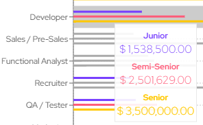

# Respuestas al Bloque A del Dictamen DEV-AE2 N.º 14/2026

**Estudiante:** Joaquín Sebastián Sánchez · DNI 45.452.416

**Proyecto:** RIGE · Proyecto Final de Grado · Ingeniería en Sistemas de Información · UCP, Sede Posadas · Comisión A

**Docente:** PosDr. Darío Ezequiel Díaz

**Fecha:** 16/10/2026

**Repositorio:** privado; acceso de colaborador enviado a diazdarioezequiel_pos@ucp.edu.ar el [COMPLETAR: fecha].

## 1. Medición con personas y medición con agentes

*¿Por qué reemplazaste la medición con personas de la AE1, que la devolución te pidió conservar y ampliar, por una medición con agentes? ¿Qué pregunta del problema enunciado en la AE1 (el costo que paga el desarrollador) deja sin responder una medición cuyo ejecutor es un modelo?*

La línea de base cambió porque cambió el eje del proyecto. En la segunda entrevista, el 24/09, la referente me contó que los cambios de configuración (permisos, modelos y agentes) ya los hacen siempre pidiéndoselos a un agente, y que para eso usan un agente propio de OpenCode, «[AUX] Charles». Después me compartió su definición. La propia herramienta empuja en esa dirección: OpenCode 1.18.25 trae de fábrica una skill que le indica al agente cómo crear y corregir la configuración del usuario, y tiene un comando que delega en un modelo la creación de agentes. Además, hay incidencias reales en el repositorio de OpenCode en las que un agente modificó la configuración y la dejó mal. Con eso, medir a personas resolviendo a mano era medir un procedimiento que el equipo de la referente ya no usa. Por eso pasé a medir el que sí usa: el que delega en un agente. Me aparté de lo que pedía la devolución de la AE1 sin consultarlo antes, y debí hacerlo.

La medición de la AE1 no se podía conservar, porque estaba mal metodológicamente. Las 64 observaciones fueron pruebas informales con amigos y compañeros: no seguí un protocolo uniforme, cambié las preguntas durante las sesiones y no conservé los registros. En la AE1 las presenté como medición, y fue un error que corrijo. Ampliarla me obligaba a empezar de cero.

Lo que encontró la medición con agentes. La hice entre el 13 y el 14/10, y su resultado me obligó a revisar el problema.

Cuando el agente tiene que averiguar qué configuración rige, casi siempre acierta. Con el criterio de corrección que fijé antes de medir, el agente principal dio 4 respuestas parciales de 54, todas en preguntas sobre el origen de una regla nativa; con el criterio que precisé después de ver los datos, acertó las 72 consultas. Aplicada la Tabla 10 del IV.3, el resultado es «Reordena» con el primer criterio y «Refuta» con el segundo. En las dos lecturas el error de atribución es bajo, y por eso el problema no estaba donde lo había puesto.

El error aparece cuando el agente tiene que modificar permisos: a veces escribe reglas que OpenCode no aplica y da el cambio por hecho. Pasó en 16 de 144 ejecuciones. Esa medición no es válida como línea de base, porque un caso de control falló y el agente operaba fuera de la carpeta del proyecto, así que la tomo como indicio y no como resultado. Una prueba adicional, sin la ruta en la instrucción, repitió la falla en 13 de 24 ejecuciones.

Reformulé el problema hacia ese punto: el desarrollador no tiene cómo verificar que un cambio de configuración produjo el efecto que buscaba. Tomé esa decisión después de ver los datos, y lo digo así. La línea de base de ese problema la mido ahora, con un diseño nuevo dentro de la carpeta del proyecto. Si RIGE reduce la falla lo va a decir la medición final, con RIGE disponible para el agente.

Lo que una medición con agentes deja sin responder. Una medición cuyo ejecutor es un modelo no mide el costo que paga la persona:

- cuánto tarda en resolver la consulta;
- con qué frecuencia se equivoca;
- cuánto le cuesta revisar lo que hizo el agente, y si llega a darse cuenta de que algo quedó sin efecto.

La tercera es la que más importa ahora. La referente me confirmó por escrito el 15/10 (constancia, punto 1.4) que, en buena parte de los casos, un cambio sin efecto no se nota en el momento y se descubre más tarde, cuando algo se comporta distinto de lo esperado. Mi medición muestra que el agente da por hecho un cambio que no tuvo efecto, pero no cuánto le cuesta a la persona descubrirlo.

Una primera aproximación a ese costo ya está en curso: una encuesta a desarrolladores, abierta el 10/10/2026, que pregunta cómo hacen hoy los cambios de configuración, si los delegan en un agente y cómo verifican el resultado. Cierra el 24/10/2026 y requiere un mínimo de 30 respuestas, criterios que fijé antes de abrirla. Por eso todavía no uso sus resultados. Es una estimación de lo que la gente declara, no una medición, y no reemplaza a la medición con personas.

Si sumo una medición con personas, como complemento de la medición con agentes y no como reemplazo, lo decido después de esas mediciones.

## 2. Validación de los siete requisitos posteriores al 26/09

*¿En qué fecha, por qué canal y sobre qué versión del catálogo confirmó la referente los siete requisitos posteriores al 26/09 (RF-12, RF-14, RF-16, RF-17, RNF-04, RNF-09 y RNF-10) y la relación nueva del modelo? ADR-073 dice «verbalmente»: ¿quién lo registró y dónde?*

La referente los confirmó el **01/10/2026**, en una charla **presencial**. Le expliqué en qué cambiaba cada requisito respecto de lo que habíamos visto el 26/09, y también la relación nueva del modelo (una declaración origina reglas de permiso), y los aceptó. La versión del catálogo era la del 01/10 (commit `8343508`), la primera que ya incluía RF-17. Los enunciados de esos siete requisitos son los mismos que figuran hoy en el catálogo.

El «verbalmente» de ADR-073 lo escribió ese mismo día el sistema de agentes con el que trabajo, a partir de lo que yo le conté de esa charla. El problema es que no quedó ningún registro firmado por ella: la extensión del acta, que tenía que llevar fecha y firma, no se completó, y en la versión entregada los siete requisitos aparecían como validados en la sesión del 26/09. Ese es el error que señala el dictamen, y es mío.

Ya está corregido. El 15/10 la referente firmó en forma presencial una constancia (Adjunto A, v1) que reúne las dos entrevistas y la extensión del 01/10, con los siete requisitos y la relación nueva. Ese mismo día firmó una segunda versión (Adjunto A, v2) en la que confirma, sin correcciones, once cambios posteriores que tampoco había visto: entre ellos, la corrección de una regla sobre subagentes que había validado el 26/09 y que la ejecución de OpenCode mostró que era incorrecta. El acta del 26/09 volvió a decir lo que se trató ese día (82 puntos), y cada cambio posterior figura en una extensión con su propia fecha.

## 3. El prototipo v0 y la maqueta del 26/09

*¿Qué ocurrió el 03/09 con el prototipo v0? El informe de la AE1 dice que se validó con constancia; el acta del 26/09 lo registra pendiente desde la AE1. ¿Y qué maqueta viste con la referente el 26/09, la de cinco pantallas del acta o la de nueve del PDF del Portafolio, que tu bitácora asocia a Claude Design?*

El 03/09 no hubo ninguna validación: la fecha del informe de la AE1 está mal. La maqueta v0, la de nueve pantallas, se la mostré a la referente en la primera entrevista, el **29/08**, y ahí dio su conformidad. La «constancia» que menciona la AE1 es el registro de esa entrevista, no un documento aparte. Hubo una segunda validación porque el proyecto cambió de eje. En la entrevista del 24/09, la referente me contó que su equipo delega la configuración en un agente, y me pidió simplificar la interfaz gráfica y sumar una interfaz de línea de comandos pensada para que la use un agente. Rehice la maqueta con ese pedido.

El **26/09 le mostré la maqueta de cinco pantallas**: la interfaz gráfica simplificada más la línea de comandos. Es la que describe el acta. El PDF de nueve pantallas es la v0 original del 29/08. Si apareció en el acta fue por un error mío: al cargar el enlace, puse la versión vieja. Ya lo corregí en el acta y en el Anexo II, y adjunto la maqueta (Adjunto B).

## 4. RNF-07 y el umbral de 2 segundos

*RNF-07: ¿por qué 2 s, si en la AE1 (A.III.1.7) descartaste expresamente el umbral cercano a dos segundos? ¿Qué parte del cambio obedece al objeto medido y qué parte a la aceptación de la referente, y cuál es la fuente del valor?*

**El cambio responde a lo que se mide.** En la AE1 fijé un segundo pensando en una persona frente a una aplicación de escritorio, que consulta datos ya cargados en memoria. Para eso usé como referencia los límites de tolerancia humana, y entre los dos valores que encontré me quedé con el más exigente. Desde la entrevista del 24/09, quien usa RIGE es sobre todo un agente, que llama a la línea de comandos una y otra vez. RNF-07 mide hoy otra operación: la invocación completa, en la que el programa arranca, lee los archivos y resuelve, sin nada cargado de antemano. Para un agente, la paciencia de una persona deja de ser el criterio. Por eso ya no sostengo ni el segundo de la AE1 ni la fuente que lo apoyaba.

**La fuente del valor es una medición propia.** La pregunta que importa ahora es cuánto tarda la alternativa que el agente usa hoy. Para saber qué configuración rige, un agente puede ejecutar el comando nativo de OpenCode, `opencode debug agent build`. El 15/10/2026 lo medí en el mismo equipo de referencia que fija RNF-07: el contenedor Ubuntu 26.04, con 12 procesadores y 8 GB, sin red. Fueron diez corridas, cada una arrancando de cero (Adjunto D):

| Corrida | 1 | 2 | 3 | 4 | 5 | 6 | 7 | 8 | 9 | 10 |
|:--|:--|:--|:--|:--|:--|:--|:--|:--|:--|:--|
| Milisegundos | 1265 | 1163 | 1131 | 1177 | 1199 | 1150 | 1176 | 1258 | 1244 | 1160 |

El comando nativo tarda alrededor de **1,2 segundos**, con un peor caso de 1,27. Con ese dato, los 2 segundos significan que RIGE tiene que responder en un tiempo del mismo orden que la herramienta que reemplaza, con un margen de unos 0,7 segundos. El dato también explica por qué no podía mantener el segundo de la AE1: ni siquiera OpenCode lo cumple.

Esta medición tiene un límite, y lo declaro: la hice sobre un proyecto chico, de tres archivos. RNF-07 se acredita sobre un proyecto del doble del tamaño de un proyecto público de referencia. Cuando construya ese proyecto, vuelvo a medir el comando nativo sobre él. Si superara los 2 segundos, reviso el umbral con la referente.

**La parte de la referente es la aceptación.** El 26/09 aceptó los 2 segundos sin tener las cifras de su propio proyecto, y el 15/10 confirmó por escrito el fundamento en el comando nativo (Adjunto A, v2, punto 4.6). Eso valida el requisito, pero no es de donde sale el número.

## 5. La prueba de RNF-03 sobre el núcleo

*¿Qué decisión arquitectónica prueba hoy la prueba de RNF-03 CA-1 sobre un núcleo de tres líneas? ¿Qué tiene que contener el v1 para que esa prueba pueda fallar?*

En lo que entregué el 02/10, **no probaba ninguna**. El núcleo era un solo archivo de tres líneas y la prueba pasaba con cualquier código. La observación del dictamen es correcta: el v1 no estaba completo.

La decisión que prueba es la arquitectura de puertos y adaptadores: un núcleo que no conoce la herramienta y un adaptador que le declara cómo se comporta OpenCode. Para que la prueba pueda fallar, el v1 tiene que tener un núcleo que de verdad resuelva, aplicando RD-01 a través del contrato del adaptador. También necesita una prueba que demuestre que el análisis detecta una dependencia prohibida cuando la hay. Eso es lo que contiene el v1 desde el 05/10, cuando se incorporó el recorrido vertical completo:

- **El núcleo resuelve.** Tiene el contrato que debe cumplir cualquier adaptador y la lógica de resolución. El adaptador de OpenCode le dice en qué orden van las entradas y cómo se combinan, y el núcleo lo aplica sin saber de qué herramienta se trata.
- **La prueba puede fallar, y lo demuestro.** Una prueba introduce a propósito en el núcleo cuatro formas distintas de importar el adaptador de OpenCode y comprueba que el análisis detecte las cuatro. Incluye además casos correctos que no deben dar falsas alarmas.
- **Un adaptador de una herramienta ficticia funciona sin tocar el núcleo** (RNF-03 CA-3). Si el núcleo dependiera de OpenCode, eso sería imposible.
- **El resultado se compara con OpenCode real.** El canal de integración continua ejecuta el binario de OpenCode 1.18.25 en Ubuntu y en Windows, y falla si su salida no coincide con la de RIGE.

El 15/10 cloné el repositorio en una computadora limpia, seguí el README y pasaron todas las pruebas. La etiqueta v1 (commit [COMPLETAR: hash de la etiqueta]) se publicó el 15/10/2026, y su corrida en el canal de integración continua terminó con éxito en Ubuntu y en Windows (Adjuntos C y E). Ese mismo día repetí la prueba en un contenedor limpio, posicionado en la etiqueta: todos los pasos del README funcionaron.

## 6. Uso de herramientas por apartado

*¿Qué apartados de los Capítulos III, IV, V y X, qué filas del catálogo y qué entradas de la bitácora produjo, reformuló o corrigió una herramienta? Una línea por apartado, con la herramienta y la fecha.*

Todas las decisiones del proyecto son mías: qué problema abordar, cómo delimitarlo, qué requisitos incluir y con qué prioridad, qué alternativa elegir en cada decisión registrada, qué validar con la referente y cómo reformular el problema después de medir. Las tomé yo, y el registro de decisiones del proyecto muestra en cada caso las alternativas, mi elección y su fecha.

Para trabajar usé un sistema de agentes que armé para el proyecto. Me ayudó en tres aspectos:

- **Revisión crítica:** un agente controlaba el cumplimiento de la consigna, buscaba contradicciones y cuestionaba explícitamente mis decisiones. Varias veces no le hice caso, y la decisión final fue siempre mía.
- **Búsqueda y verificación:** búsqueda de competidores y de fuentes, y verificación de citas y cifras.
- **Redacción:** un agente redactó y corrigió texto a partir de mis decisiones. Lo declaro apartado por apartado:

| Apartado | Herramienta | Qué hizo | Fecha |
|:--|:--|:--|:--|
| Caps. III, IV, V y X completos, Anexos, Libro de trabajo e Instrumentos 24, 27 y 34 | Claude Code (subagentes) y Codex | Redacción y corrección sobre fichas, a partir de mis decisiones | 25/09 al 02/10/2026 |
| IV.4 (nómina de competidores) | Codex con búsqueda web | Búsqueda de competidores | 01/10/2026 |
| Anexo I y Libro (RF-02 CA-9 y RF-07) | Claude Code (subagente) | Redacción de criterios | 14/10/2026 |
| III.1, III.2, III.4, III.5, IV.1, IV.3, X.1; Anexos I, II, V y VI; Libro | Codex | Correcciones posteriores al dictamen | 13 al 16/10/2026 |
| Bitácora, todas las entradas desde el 25/09 | Claude Code | Borradores de cada entrada, que después revisé | 25/09 al 15/10/2026 |
| Línea de base | Claude Code | Adjudicó por delegación mía las 61 respuestas que requerían revisión manual; el criterio lo confirmé yo, y después revisé y firmé una preclasificación a ciegas | 13 y 14/10/2026 |
| Respuestas al Bloque A | Claude Code | Sugirió correcciones a mi texto | 16/10/2026 |

Entiendo que declararlo no lo vuelve admitido. Por eso, todo lo que redactó una herramienta lo voy a reescribir yo, a mano, en los Capítulos III, IV, V y X, el catálogo y la bitácora. La nueva versión del informe va a reflejar esa reescritura, y cualquier apartado que todavía no haya podido reescribir lo voy a señalar en la entrega.

## 7. El costo de la hora de desarrollo

*¿De qué página y de qué tabla del informe de Sysarmy 2026.01 sale $1.538.500, y en qué fecha lo verificaste vos?*

No sale de una página ni de una tabla de un informe escrito. El artículo de resultados de Sysarmy (6 de marzo de 2026) informa la participación, con 4939 respuestas analizadas, pero no publica cifras salariales: para el detalle remite al análisis de OpenQube. Cuando redacté el X.1 tomé la cifra de un sitio que reproduce esos resultados, sin ir a la fuente original. Fue un error.

La verifiqué el 15/10/2026 en ese análisis, el tablero oficial de la encuesta publicado por OpenQube (<https://sueldos.openqube.io/encuesta-sueldos-2026.01/>). Está en la sección «Salarios», apartado «Según Puesto», gráfico «Salarios según rol y experiencia», panel «Para salarios no dolarizados». Ahí, el rol Developer, columna Junior, marca $1.538.500. Según el propio tablero, son salarios brutos, «previo a cargas sociales e impuestos». Adjunto la captura (Adjunto F).

Al verificarla encontré que el X.1 la describe mal. No es «la mediana junior» en general, sino la mediana del rol Developer con experiencia junior, en sueldos no dolarizados. La mediana junior de todos los roles es otra, $1.700.000. Igual, para el proyecto el dato correcto es el de Developer, porque lo que se costea es trabajo de desarrollo. En la nueva versión del informe la cifra se presenta con su nombre exacto y se cita el tablero. Como el valor no cambia, el costo del período tampoco.

## 8. El repositorio de la AE1

*¿Qué pasó con el repositorio de la AE1 (TIF-Sanchez-IngSistemas-UCP), que hoy responde 404, y dónde quedó el trabajo del 07 al 23/09 que el 24/09 entró como «migración del AE1 y capítulos III a V»?*

El repositorio de la AE1 lo eliminé por decisión propia y lo reemplacé por el actual. Tenía un solo commit, el de la entrega de la AE1, así que no guardaba ningún historial posterior. Al borrarlo dejé sin destino los enlaces del informe de la AE1 y del Portafolio, y tendría que haberlo avisado. Corrijo esos enlaces para que apunten al repositorio actual.

El trabajo del 07 al 23/09 lo hice en archivos locales, sin control de versiones, así que no existe un historial día por día de ese período. Entró todo junto al repositorio actual el 24/09: el informe de la AE1, los borradores de los Capítulos III a V, las decisiones registradas hasta ese momento y el Libro de trabajo. Ese ingreso es la única constancia del estado del trabajo al cierre del período.

## Adjuntos

| | Documento | Respalda | Enlace |
|:--|:--|:--|:--|
| A | Constancias firmadas por Valeria Areco el 15/10/2026: v1 (entrevistas y extensión del 01/10) y v2 (once cambios posteriores) | Preguntas 1, 2, 3 y 4 | En el repositorio: `01-relevamiento/validacion/20261015_ConstanciaEntrevistas_Sanchez_v1_firmada.pdf` y `…_v2_firmada.pdf` |
| B | Maqueta reformulada, cinco pantallas (26/09/2026) | Pregunta 3 | <https://drive.google.com/file/d/1kz3OvG5lBim2Yb0Wyem856Li3syry-Px/view?usp=sharing> |
| C | Etiqueta v1 | Pregunta 5 | <https://github.com/Joassanchez/RIGE-TIF-Sanchez-IngSistemas-UCP/tree/v1> |
| D | Medición del comando nativo de OpenCode (15/10/2026) | Pregunta 4 | En el repositorio: `01-relevamiento/evidencia/rnf07-comando-nativo_20261015.md` |
| E | Corrida del canal de integración continua sobre la etiqueta (15/10/2026, exitosa en Ubuntu y Windows) | Pregunta 5 | <https://github.com/Joassanchez/RIGE-TIF-Sanchez-IngSistemas-UCP/actions/runs/38822464930> |
| F | Captura del tablero de OpenQube, rol Developer, Junior, sueldos no dolarizados (15/10/2026) | Pregunta 7 | <https://sueldos.openqube.io/encuesta-sueldos-2026.01/#Salarios-Segun-Puesto-Salarios-segun-rol-y-experiencia> |

**Adjunto F.** Captura del tablero de OpenQube (15/10/2026).

