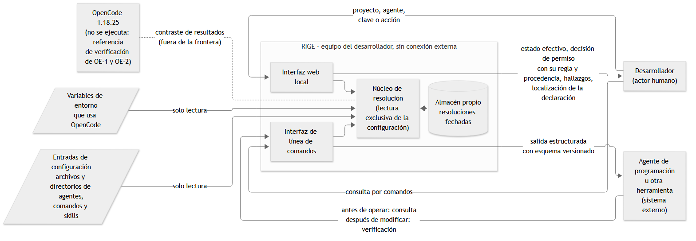

## I.6 · Descripción detallada del Sistema de Información

### I.6.1 · Elementos del ecosistema y criterio de inclusión

RIGE abarca los elementos de configuración que determinan el comportamiento de los agentes o su capacidad de acción en un proyecto de OpenCode 1.18.25, con las exclusiones del apartado I.6.5. El criterio comprende los elementos declarados por el usuario y los nativos documentados, como los agentes `build` y `plan`. La incorporación de los agentes internos del episodio relatado en I.1.3 queda condicionada a verificar su existencia y las acciones que ejecutan (Anexo VI, A.VI.3, resultado 18).

El agente es el eje de la representación porque sobre él se manifiesta el efecto de la configuración. Se descarta organizarla por archivo porque este no representa ese efecto y presupone que quien se incorpora a un proyecto ajeno conoce qué archivos existen (Anexo III, D-08).

La Tabla 6 delimita los elementos considerados y distingue sus vínculos diferidos. La resolución comprometida informa valores por agente y clave; la representación de relaciones pertenece a RF-13, Could, fuera del período (apartado III.4).

| **Elemento**          | **Información considerada en la resolución**                                                                                                                                       | **Relaciones diferidas (RF-13)**                                                                  |
|-----------------------|-------------------------------------------------------------------------------------------------------------------------------------------------------------------------------------|--------------------------------------------------------------------------------------------------|
| Agentes y subagentes  | Valores efectivos, procedencia, declaraciones desplazadas y permisos. Se distinguen los declarados por el usuario y los nativos, con la condición indicada para los agentes internos | Modelo asignado, instrucciones aplicables, herramientas disponibles y comandos que los invocan |
| Proveedores y modelos | Modelo efectivo por agente y proveedor declarado | Agentes que utilizan cada modelo |
| Permisos              | Decisión por acción, cadena de reglas y regla determinante. El subagente se rige por sus reglas propias y las denegaciones de `task` y `todowrite` previstas en RF-02, CA-3 | Agentes sobre los que rigen las reglas |
| Instrucciones         | Archivos de alcance global y de proyecto como entradas. Su orden de incorporación queda fuera del compromiso del período y las instrucciones de subdirectorios quedan excluidas (apartado III.4) | Agentes que las reciben |
| Comandos              | Definición efectiva y procedencia | Agente que invocan |
| Skills                | Disponibilidad y ubicación | Agentes que pueden utilizarlas |
| Servidores MCP        | Declaración efectiva y estado de habilitación | Herramientas que aportan y agentes con acceso a ellas |
| Servidores LSP        | Servidor efectivo por lenguaje, procedencia de la declaración y estado de habilitación | Lenguajes cubiertos y agentes que reciben diagnósticos y navegación de símbolos de cada servidor |
| Plugins               | Declaración, origen y estado de carga declarado | — |

*Tabla 6. Elementos del ecosistema considerados por RIGE y relaciones diferidas. Fuente: elaboración propia sobre el esquema de configuración de OpenCode 1.18.25, verificado en el Anexo VI, A.VI.3.*

### I.6.2 · Componentes funcionales

RIGE se organiza en seis funciones que descubren las entradas de configuración, resuelven sus valores y explican los resultados. La Tabla 7 distingue las funciones comprometidas de las capacidades condicionadas o diferidas.

Las funciones se exponen por dos interfaces sobre las mismas resoluciones. La interfaz de línea de comandos es la interfaz completa: ofrece las consultas comprometidas con salida estructurada para agentes, otras herramientas y desarrolladores que trabajan en la terminal. La interfaz web local se limita a formularios y vistas de consulta para la inspección humana; sus funciones también están disponibles por línea de comandos.

Esta distribución responde a la práctica relevada: el equipo consultado ya interroga la configuración mediante un agente con permisos elevados (Anexo VI, A.VI.5). Se descarta conservar solo la interfaz gráfica porque dejaría sin atender a ese consumidor programático (Anexo III, D-17). La resolución de RIGE no depende de un modelo de lenguaje; el costo del procedimiento delegado completo se evalúa mediante la salvaguarda del apartado I.3.4.

| **Cód.** | **Función**                                      | **Descripción**                                                                                                                                                                                                                                                                                                                                                                                                                                                                                           | **Objetivo** |
|----------|--------------------------------------------------|-----------------------------------------------------------------------------------------------------------------------------------------------------------------------------------------------------------------------------------------------------------------------------------------------------------------------------------------------------------------------------------------------------------------------------------------------------------------------------------------------------------|--------------|
| F1       | Descubrimiento del ecosistema | Localiza las entradas aplicables y los elementos declarados, con archivo y posición cuando corresponde. Registra las sustituciones de variables de entorno y de archivos, y advierte cuando la versión instalada de OpenCode difiere de la 1.18.25. | OE-1 |
| F2       | Resolución con procedencia | Determina el valor efectivo de cada clave de un agente, con la declaración determinante, las declaraciones desplazadas o la indicación de valor implícito, y lo presenta en forma tabular. Conserva y recupera resoluciones fechadas con el resumen de las entradas leídas (RF-17, Must). | OE-1 |
| F3       | Relaciones del ecosistema | Representa vínculos entre modelos, agentes, comandos, herramientas de servidores MCP y skills. RF-13, Could, queda diferido fuera del período (apartado III.4). | — |
| F4       | Explicación de permisos | Evalúa la decisión para un agente y una acción, con la cadena de reglas, la regla determinante y su explicación. Distingue reglas nativas y declaradas. Aplica al subagente sus reglas propias y las denegaciones de `task` y `todowrite` según RF-02, CA-3. La matriz y la consulta inversa quedan diferidas (RF-15, Won't en el período; apartado III.4). | OE-2 |
| F5       | Verificación y resumen | Detecta referencias no resueltas, reglas de permiso sin efecto, elementos sin uso, sustituciones sin valor, entradas ilegibles y entradas descartadas sin error visible (RF-07). Advierte cuando una declaración desactiva una protección nativa (RF-09). El resumen por tipo de elemento y de hallazgo queda condicionado a las horas (RF-11, Should; apartado III.4). | OE-3 (seis tipos de hallazgo); OE-2 (aviso de protección nativa) |
| F6       | Exploración y exportación | Informa la localización como `ruta:línea:columna`, con ruta absoluta, reconocible como enlace por el editor o la terminal (RF-12, Should condicionado). La función opera sin integración con un editor externo. La exploración libre queda fuera del período. La consulta del estado completo, cuya salida redirigida es la exportación, queda diferida (RF-14, Could; apartado III.4). | — |

*Tabla 7. Componentes funcionales de RIGE y objetivo que verifica cada uno. Fuente: elaboración propia.*

La explicación en lenguaje natural se reserva para las decisiones de permiso de F4 y los hallazgos de F5, donde responde el motivo del resultado. Se construye mediante plantillas deterministas sobre el rastro de resolución, con la regla determinante, su posición, el motivo de su prevalencia y las reglas desplazadas. Se descarta generarla con un modelo de lenguaje porque exigiría conexión saliente y agregaría variabilidad ante entradas idénticas (Anexo III, D-21).

La explicación se presenta junto a cada decisión y hallazgo en la interfaz web local. Por línea de comandos se solicita con `--explicar` y contiene el mismo texto; sin esa opción, la salida contiene los datos estructurados. La coincidencia con el comportamiento de OpenCode se verifica para mitigar el riesgo del apartado I.3.5. El criterio de resolución final por agente, frente a la configuración que muestra `opencode debug config`, se establece en el apartado I.2.4.

### I.6.3 · Estados y definiciones

La Tabla 8 reúne las distinciones necesarias para interpretar las salidas. Las definiciones completas de valor efectivo, procedencia, valor implícito, regla nativa y elemento nativo se consultan en el glosario del Anexo V.

| **Término**            | **Definición operativa**                                                                                                                                                                                                                            |
|------------------------|-----------------------------------------------------------------------------------------------------------------------------------------------------------------------------------------------------------------------------------------------------|
| Declaración sin efecto | Denominación general de una declaración que no produce el efecto esperado. Su causa se precisa mediante los estados siguientes; no identifica un tipo adicional de hallazgo. |
| Declaración desplazada | Declaración reemplazada por otra de mayor precedencia sobre la misma clave. |
| Regla sin efecto       | Regla de permiso que nunca determina una decisión. Puede quedar sombreada por una regla posterior del mismo tipo que abarca todos sus casos, según la noción adaptada de Al-Shaer y Hamed (2004). También puede contener un patrón que no coincide con ninguna acción posible, como una ruta absoluta del árbol de trabajo. |
| Referencia no resuelta | Declaración que nombra por su nombre un elemento que no figura en la resolución, o un archivo inexistente. |
| Elemento sin uso       | Elemento declarado al que ninguna declaración de un agente ni de un comando nombra. |
| Sustitución sin valor  | Sustitución de una variable de entorno no definida, que se reemplaza por un texto vacío sin advertencia. |
| Entrada ilegible       | Entrada que no puede interpretarse por errores de sintaxis o por referenciar una sustitución de archivo inexistente. Su carga se detiene con error. |
| Entrada descartada sin error visible | Entrada que la herramienta desestima por contener un contenido inválido, cuyo descarte solo consta en el archivo de registro. Se distingue de la entrada ilegible, que produce error. |

*Tabla 8. Estados informados por RIGE. Fuente: elaboración propia; noción de sombreado adaptada de Al-Shaer y Hamed (2004).*

Cada valor efectivo se informa con su procedencia y sus declaraciones desplazadas o la indicación de valor implícito, conforme al OE-1. La decisión de permiso incluye la acción evaluada y la cadena de reglas coincidentes en orden de evaluación. Se identifica la regla determinante con su procedencia y carácter nativo o declarado, conforme al OE-2.

La protección de RNF-04 abarca todas las sustituciones de variables de entorno y de archivos, incluidas las contenidas en una variable que actúa como entrada de configuración. Se informa su origen y su condición de definido o no definido. El contenido incorporado por sustitución queda protegido en todos los destinos: interfaz, línea de comandos, diagnóstico y almacén propio.

### I.6.4 · Frontera, actores, entradas y salidas

RIGE opera sobre el equipo del desarrollador sin conexión con servicios externos y tiene dos actores. El desarrollador, único actor humano, consulta por la interfaz web local o por la línea de comandos. El segundo actor es un sistema externo: el agente de programación u otra herramienta que invoca la línea de comandos. Consulta el estado efectivo antes de operar y, después de modificar la configuración, verifica mediante RIGE la decisión o el valor resultante.

Ambos actores reciben respuestas sobre las mismas entradas de configuración. La interfaz web la sirve el propio proceso de RIGE en la dirección local del equipo, sin aceptar conexiones de otros equipos. La lectura exclusiva protege las entradas: RIGE escribe únicamente en su almacén propio. Allí conserva y recupera las resoluciones con su fecha y el resumen de las entradas leídas, conforme a RF-17.

La Tabla 9 sintetiza las entradas y salidas de la frontera y sitúa el almacén dentro de ella. La Figura 1 representa el contexto del sistema.

| **Elemento o actor**                                                  | **Relación con la frontera**                                                                                                                                                                                                                 |
|-----------------------------------------------------------------------|----------------------------------------------------------------------------------------------------------------------------------------------------------------------------------------------------------------------------------------------|
| Desarrollador                                                         | Entrada, por la interfaz web local o la línea de comandos: proyecto, agente, clave o acción a consultar y resolución a recuperar. Salida: valores efectivos con procedencia, decisiones de permiso explicadas y hallazgos. |
| Agente de programación u otra herramienta (sistema externo) | El actor consulta antes de operar y verifica el resultado después de modificar la configuración. Envía el proyecto, agente, clave o acción por parámetros del comando. RIGE devuelve valores efectivos, decisiones de permiso y hallazgos conforme a un esquema publicado y versionado, con explicación a pedido. La aplicación de cambios corresponde al actor externo. |
| Archivos de configuración y directorios de agentes, comandos y skills | Entradas de solo lectura. Permanecen fuera de la frontera como registros que OpenCode aplica. |
| Variables de entorno                                                  | Entrada de solo lectura, limitada a las variables que OpenCode utiliza en su configuración. |
| Localización de declaraciones                                         | Salida en formato `ruta:línea:columna`, con ruta absoluta, reconocible como enlace (RF-12, Should condicionado). La apertura y la edición corresponden al editor o a la terminal del desarrollador. |
| Almacén propio de RIGE                                                 | Dentro de la frontera. RIGE escribe y recupera resoluciones fechadas con el resumen de las entradas leídas, conforme a RF-17, y protege el contenido de las sustituciones conforme a RNF-04. |
| OpenCode 1.18.25                                                       | Fuera de la frontera. RIGE no lo ejecuta ni lo modifica durante su funcionamiento. Su comportamiento es la referencia contra la que se verifican los resultados de OE-1 y OE-2 (Anexo III, D-44). |

*Tabla 9. Actores, elementos externos y almacén propio. Fuente: elaboración propia.*

*Figura 1. Diagrama de contexto de RIGE. Elementos externos, entradas y salidas que atraviesan la frontera del sistema. Fuente: elaboración propia.*

Las variables de entorno leídas corresponden al proceso de RIGE, que puede diferir del entorno de la terminal desde la que se ejecuta OpenCode. Se advierte cuando una variable relevante no está definida; la limitación se recoge en el apartado I.6.5.

El análisis es estático: describe el estado resultante de las entradas de configuración. Una aprobación persistida conserva la autorización permanente concedida por el desarrollador para el texto literal de una acción y subsiste entre sesiones. Evita que una acción sujeta a confirmación vuelva a solicitarla; una denegación declarada prevalece sobre esa aprobación. Los comandos de introspección omiten estas aprobaciones (Anexo VI, A.VI.3, resultado 11). RIGE no accede a su registro y declara esa condición junto a cada decisión de permiso, por ambas interfaces.

### I.6.5 · Alcance y exclusiones declaradas

La Tabla 10 resume las inclusiones y exclusiones necesarias para interpretar las consultas. Los límites completos y las capacidades diferidas se detallan en el apartado III.4.

| **Se incluye**                                                                                                                                               | **Se excluye**                                                                                                                                        | **Motivo de la exclusión**                                                                                                                                                                                                                                                 |
|--------------------------------------------------------------------------------------------------------------------------------------------------------------|-------------------------------------------------------------------------------------------------------------------------------------------------------|----------------------------------------------------------------------------------------------------------------------------------------------------------------------------------------------------------------------------------------------------------------------------|
| Lectura de la configuración y escritura de resoluciones en el almacén propio | Edición de las entradas de configuración | Las entradas son el registro que OpenCode aplica. La edición existe en las soluciones relevadas en I.1.3 y altera el estado que se audita. |
| OpenCode 1.18.25 | Otras herramientas y versiones | La versión fija sostiene la verificación. La incorporación de otras herramientas queda diferida (apartado III.4). |
| Entradas del entorno individual: global, personalizada, de proyecto, directorios de la herramienta y variables de entorno | Configuración remota y administrada a nivel de sistema operativo, incluidas preferencias gestionadas y rutas globales de sistema | Las políticas corporativas exceden la frontera individual del apartado I.6.4 y requieren privilegios administrativos. |
| Elementos que determinan el comportamiento de los agentes | Configuración de la interfaz de OpenCode | El tema visual y los atajos de teclado no alteran el comportamiento ni la capacidad de acción de los agentes. |
| Proveedores y modelos declarados | Credenciales de autenticación | Son datos sensibles que determinan el acceso a los modelos. |
| Permisos declarados y reglas nativas | Aprobaciones persistidas | Se almacenan fuera de las entradas de configuración. Su efecto y la advertencia que acompaña cada decisión se describen en I.6.4. |
| Evaluación estática de la decisión para un agente y una acción | Ejecutar la acción u OpenCode para comprobar el efecto | La herramienta actúa como referencia según la Tabla 9. Se descarta ejecutarla desde RIGE para conservar la independencia del producto respecto de esa referencia (Anexo III, D-44). La comparación con esa vía de comprobación se recoge en I.3.4. |
| Comandos de terminal simples | Comandos compuestos: tuberías, encadenamientos, redirecciones, subshells y sustituciones de comandos | Su evaluación exige reproducir el análisis sintáctico de la herramienta. RIGE identifica el comando compuesto y advierte la limitación. |
| Plugins declarados, con su origen | Efecto del código de los plugins sobre la configuración | Determinarlo exige ejecutar código de terceros, fuera de la lectura estática. |
| Declaración y habilitación de servidores MCP | Disponibilidad, contenido y seguridad de esos servidores | Corresponden al objeto de los escáneres de seguridad relevados en I.1.3. |
| Detección de entradas ilegibles | Validación completa contra el esquema | La validación completa es una función distinta de la resolución del estado efectivo. |
| Instrucciones globales y de proyecto como entradas de configuración | Instrucciones de subdirectorios y evaluación de la calidad del contenido | La incorporación de instrucciones de subdirectorios depende de los archivos leídos durante la sesión. La evaluación de calidad examina el contenido de las instrucciones. El orden de incorporación queda fuera del compromiso del período (apartado III.4). |
| Variables de entorno del proceso de RIGE | Entorno de ejecución de una sesión concreta de OpenCode | RIGE opera sin conectarse a la ejecución de OpenCode y declara esa limitación. |
| Consulta de valores efectivos, decisiones y hallazgos por línea de comandos, con esquema versionado y explicación a pedido | Escritura, modificación o generación de configuración y ejecución de acciones sobre el proyecto | La lectura exclusiva protege las entradas por ambas interfaces. Generar configuración exige decidir qué declarar. |
| Línea de comandos como vía programática | Biblioteca de integración o kit de desarrollo | El comando cubre el caso relevado con un contrato de datos acotado. Se descarta agregar una biblioteca porque compromete una superficie de funciones mayor (Anexo III, D-17). La compatibilidad entre versiones queda fuera de esta etapa para ambas vías. |
| Persistencia y recuperación de resoluciones fechadas (RF-17, Must) | Comparación entre estados resueltos | La comparación exige interfaz y pruebas propias. La consulta del estado completo y su exportación quedan diferidas (RF-14, Could; apartado III.4). |
| Consulta por agente y acción y vistas web limitadas de valores, permisos y hallazgos | Relaciones, exploración libre, matriz y consulta inversa | Las relaciones quedan diferidas (RF-13, Could; L-12). La matriz y la consulta inversa son Won't en el período (RF-15). El resumen es Should condicionado a las horas (RF-11), según III.4. |
| Uso individual y local | Uso compartido, en servidor o por equipos | Corresponde a la frontera declarada en I.6.4. |

*Tabla 10. Inclusiones y exclusiones del alcance. Fuente: elaboración propia.*

### I.6.6 · Prototipo v0

La maqueta validada el 26/09/2026 reformula la presentada el 29/08/2026 a partir del pedido de la referente en la entrevista del 24/09/2026 (Anexo VI, A.VI.5). Simplifica la interfaz gráfica a cinco pantallas y representa la consulta por línea de comandos para un agente (Anexo II, A.II.2). Las herramientas generativas se utilizan como apoyo para construir en HTML la maqueta navegable, de baja fidelidad y no funcional. Sus datos son ilustrativos: no calcula, no persiste ni lee archivos.

Se adopta la baja fidelidad para detectar errores de flujo. Se descarta la alta fidelidad por el criterio general de que una maqueta terminada tiende a recibir una crítica más moderada (Anexo III, D-09). Los casos de atribución se conservan como antecedente del flujo (Anexo VI, A.VI.1, Tabla A.VI.2).

El recorrido gráfico comprende cinco pantallas:

1. Selección del proyecto.
2. Resumen del ecosistema y de sus hallazgos.
3. Detalle de un agente, con valores efectivos, procedencia, declaraciones desplazadas y elementos relacionados.
4. Consulta de permiso, con decisión, cadena de reglas y regla determinante.
5. Detalle de un hallazgo, con la localización de la declaración que lo origina.

La referente, Valeria Areco, valida el recorrido en la sesión presencial del 26/09/2026. El acta registra conformidad con las cinco pantallas y su orden, sin observaciones ni cambios solicitados (Anexo II, A.II.1). El aporte principal identificado por la referente se recoge en I.3.5.

El resumen del ecosistema (RF-11, Should) queda condicionado a las horas; los hallazgos (RF-07, Must) integran el compromiso. Los elementos relacionados del detalle del agente (RF-13, Could) quedan diferidos por L-12. Las pantallas se interpretan dentro de los límites de la interfaz web local y las demás salvedades del apartado III.4. Las capturas constan en el Anexo II, A.II.2. La maqueta reformulada, con su versión en PDF, se encuentra en <https://drive.google.com/file/d/1kz3OvG5lBim2Yb0Wyem856Li3syry-Px/view?usp=sharing>.
