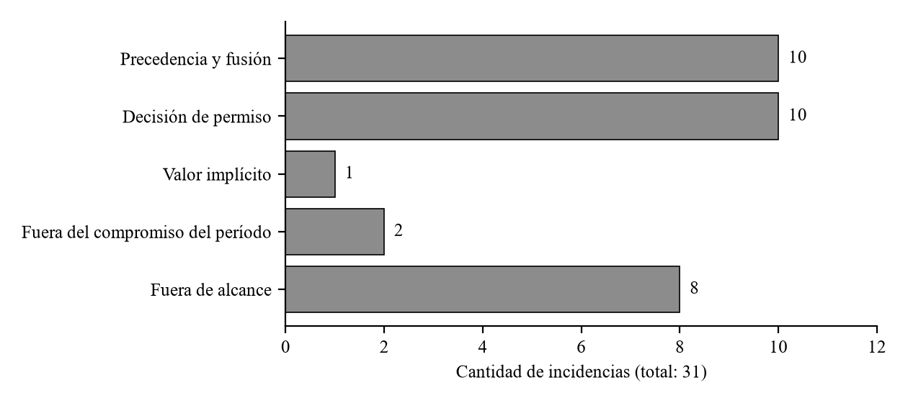

## II.4 · Gráficos y variables de análisis

Las Figuras 2 y 3 representan los datos del apartado II.3 y se insertan dentro del capítulo, numeradas de manera correlativa con la Figura 1 del apartado I.6.4.

### II.4.1 · Distribución de las incidencias por mecanismo

*Figura 2. Incidencias de OpenCode por mecanismo: precedencia y fusión (10), decisión de permiso (10), valor implícito (1), fuera del compromiso del período (2) y fuera de alcance (8). Eje horizontal: cantidad de incidencias. Eje vertical: mecanismo asignado. n = 31 incidencias incluidas sobre 46 candidatas. Fuente: relevamiento del autor mediante búsqueda y clasificación por título, con un codificador, sobre el historial público del repositorio. Período de apertura: 28/11/2025 a 16/09/2026; consulta del 17/09/2026 y revisión del 09/10/2026 (Anexo VI, A.VI.6).*

La distribución delimita los mecanismos que documenta el corpus, cuya clasificación carece de casos de ruta absoluta. Se conserva como antecedente general de configuración; la verificación del mecanismo de ruta absoluta se apoya en los antecedentes complementarios y en la línea de base (apartados II.3.1 y II.3.2).

Los datos cualitativos de la entrevista se conservan en el apartado II.3.3; el alcance del instrumento consta en el apartado II.2.4.

### II.4.2 · Éxito declarado falso por problema de E2

Cada fila de la Figura 3 corresponde a un problema de E2 y cada marcador indica cuántas de las tres repeticiones de un ejecutor terminan con éxito declarado falso. La línea marca el umbral de dos de tres repeticiones; las filas sombreadas identifican los cinco problemas con éxito declarado falso y se señalan los dos con exposición.

*Figura 3. Éxito declarado falso por problema de E2 en la línea de base, con `build` y Charles. Eje horizontal: repeticiones de tres con éxito declarado falso. Eje vertical: problema de E2. n = 33 problemas, tres repeticiones por ejecutor, lectura principal. Fuente: elaboración propia sobre los informes del reanálisis del 22/10/2026 de la medición del 20 y el 21/10/2026 (registro de la evidencia, Anexo VI, A.VI.11).*
