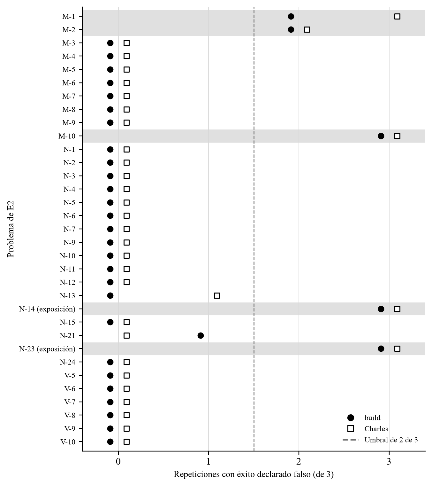

## II.4 · Gráficos y variables de análisis

Las Figuras 2 y 3 representan los datos del apartado II.3 y se insertan dentro del capítulo, numeradas de manera correlativa con la Figura 1 del apartado I.6.4.

### II.4.1 · Distribución temporal de las incidencias relevadas

| *\[Figura 2 — pendiente de incorporación\]* |
|---------------------------------------------|

*Figura 2. Incidencias de configuración y permisos del repositorio de OpenCode por mes de apertura. Eje horizontal: mes de apertura de la incidencia. Eje vertical: cantidad de incidencias incluidas en el relevamiento. n = 31 incidencias incluidas sobre 46 candidatas. Fuente: elaboración propia sobre el relevamiento del 17/09/2026; nómina completa en el Anexo VI, A.VI.6.*

La figura representa las 31 incidencias incluidas según el mes en que fueron abiertas. La última columna corresponde a un mes parcial, cerrado el 16 de septiembre de 2026 por ser la fecha de consulta.

No se produce una figura para los datos de la entrevista. Con un solo informante, toda representación gráfica sugeriría una distribución que el relevamiento no tiene, y los datos del apartado II.3.3 expresan el dato con la precisión que le corresponde.

### II.4.2 · Éxito declarado falso por problema de E2

Cada fila de la Figura 3 corresponde a un problema de E2 y cada marcador indica cuántas de las tres repeticiones de un ejecutor terminan con éxito declarado falso. La línea marca el umbral de dos de tres repeticiones; las filas sombreadas identifican los cinco problemas con éxito declarado falso y se señalan los dos con exposición.

*Figura 3. Éxito declarado falso por problema de E2 en la línea de base, con `build` y Charles. Eje horizontal: repeticiones de tres con éxito declarado falso. Eje vertical: problema de E2. n = 33 problemas, tres repeticiones por ejecutor, lectura principal. Fuente: elaboración propia sobre los informes del reanálisis del 22/10/2026 de la medición del 20 y el 21/10/2026, en `01-relevamiento/linea-base/verificacion/20261021-LB-ADR098/`.*
