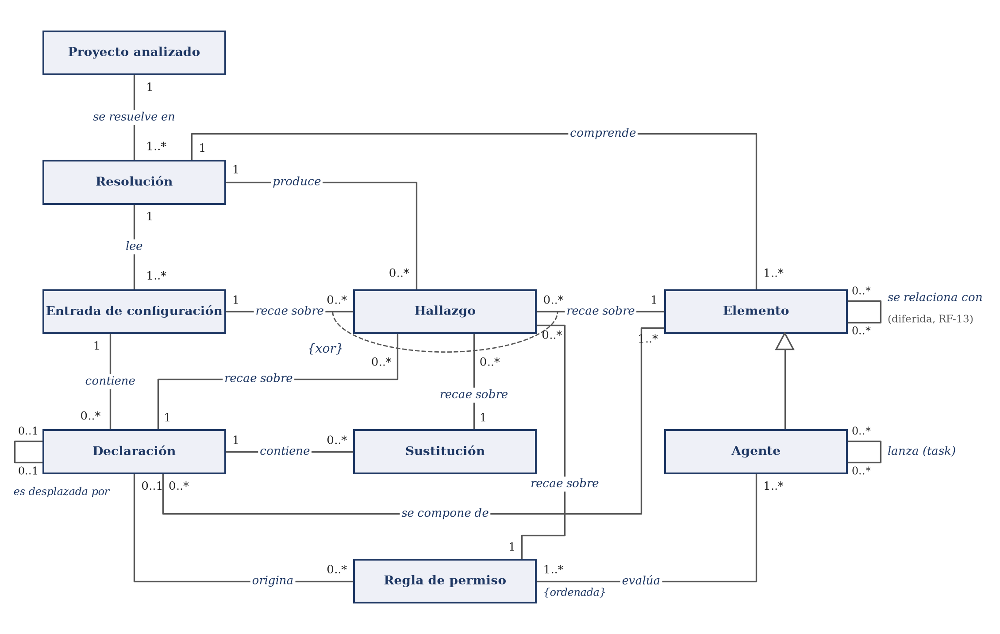

## III.2 · Dominio del Sistema de Información

### III.2.1 · Frontera entre el entorno y el dominio

El dominio es el recorte del mundo que el sistema representa y sobre cuyo estado responde. La frontera aplica una prueba: si RIGE controla el estado de un objeto o lo padece. El archivo de configuración pertenece al entorno, porque RIGE recibe el contenido escrito por otros, mientras que su representación resuelta pertenece al dominio. Esta distinción sostiene el modo de operación de solo lectura del apartado III.4.

### III.2.2 · Entidades del dominio

El modelado identifica sustantivos del dominio (Larman, 2004) a partir del vocabulario del esquema, el código y la documentación de OpenCode 1.18.25 (Anexo VI, A.VI.3), contrastado con la referente para compartir un vocabulario único (Evans, 2003). Cada candidata ingresa como entidad si satisface las tres pruebas de identidad propia, datos y reglas propios y pertenencia al recorte delimitado; sus atributos constan en el Anexo V.

| **Entidad**              | **Definición operativa**                                                                             | **Fuente que la acredita**       | **Relaciones principales**                                                      |
|--------------------------|------------------------------------------------------------------------------------------------------|----------------------------------|---------------------------------------------------------------------------------|
| Proyecto analizado       | Contexto sobre el cual se resuelve el estado efectivo de la configuración                            | apartado I.6.4               | Se resuelve en muchas resoluciones                                              |
| Resolución               | Estado efectivo del ecosistema obtenido en un momento determinado                                    | A.VI.3, resultados 1 y 3          | Lee muchas entradas; comprende muchos elementos; produce muchos hallazgos                                   |
| Entrada de configuración | Vía por la cual OpenCode incorpora configuración al resolver el estado efectivo, sea o no un archivo | A.VI.3, resultado 1               | Contiene ninguna o muchas declaraciones                                                   |
| Declaración              | Asignación concreta escrita dentro de una entrada                                                    | A.VI.3, resultados 3 y 6          | Compone uno o muchos elementos; puede desplazar a otra declaración; contiene sustituciones |
| Sustitución              | Reemplazo de una variable de entorno o de un archivo dentro de una declaración                       | A.VI.3, resultado 13              | Pertenece a una declaración; puede ser objeto de un hallazgo              |
| Elemento                 | Unidad de configuración que RIGE resuelve y relaciona, cuyo tipo declara el adaptador                | A.VI.3, resultado 1; AE1, Tabla 6 | Pertenece a una resolución; se compone de ninguna o muchas declaraciones; se relaciona con otros elementos  |
| Agente                   | Especialización de Elemento sobre la cual se manifiesta el efecto de toda la configuración           | A.VI.3, resultados 5 y 12         | Evalúa una cadena de reglas; invoca muchos subagentes y puede ser invocado por muchos agentes |
| Regla de permiso         | Regla que produce una decisión de permiso, nativa de la herramienta o escrita por el usuario en una declaración | A.VI.3, resultados 5, 7 y 8 | Rige sobre uno o muchos agentes; ocupa una posición en la cadena; si es declarada, proviene de una declaración |
| Hallazgo                 | Defecto detectado en el ecosistema, con su localización                                              | A.VI.3, resultados 3, 5, 13 y 14      | Recae sobre un elemento, una declaración, una entrada o una sustitución                          |

*Tabla 2. Entidades del dominio, con su fuente y sus relaciones principales. Fuente: elaboración propia sobre el relevamiento técnico del Anexo VI, A.VI.3.*

Las candidatas descartadas se conservan con su reclasificación, porque el descarte documentado es lo que permite defender la delimitación adoptada.

| **Candidata**                                      | **Reclasificación**                               | **Criterio**                                                                    |
|----------------------------------------------------|---------------------------------------------------|---------------------------------------------------------------------------------|
| Valor efectivo                                     | Atributo de otra entidad                              | Atributo derivado del elemento, que resulta de cada resolución, igual que la procedencia                    |
| Procedencia | Atributo de otra entidad | Atributo del elemento, junto con su valor efectivo: es la cadena que conduce a la declaración determinante, no una cosa del dominio |
| Archivo | Atributo de otra entidad | Atributo de la entrada (su ruta). Como objeto del disco pertenece al entorno: el sistema lo recibe ya formado y no lo modifica |
| Consulta de permiso                                | Producto del sistema                              | Sus datos son referencias a otras entidades; no posee datos propios             |
| Desarrollador | Elemento del entorno | Actor externo, conforme al apartado III.1 |
| Agente que consume la salida por línea de comandos | Elemento del entorno | Sistema vecino, conforme al apartado III.1 (E-01) |
| Versión de OpenCode | Atributo de otra entidad | Atributo de la resolución y del proyecto analizado; opera además como restricción del entorno. No posee datos ni reglas propios dentro del sistema |
| Credencial de autenticación | Elemento del entorno | Excluida del alcance, conforme al apartado III.4 (L-03) |

*Tabla 3. Candidatas descartadas con su reclasificación. Fuente: elaboración propia.*

Agente es la única especialización de Elemento porque concentra la cadena de reglas de permiso, las denegaciones que se agregan a los subagentes y las instrucciones aplicables, y constituye el eje de la representación, mientras los restantes tipos comparten el tratamiento de resolución y relación.

### III.2.3 · Modelo del dominio

Las relaciones se enuncian como frases del negocio y constan con su multiplicidad en el Anexo V, A.V.4. Once se validan con la referente en la sesión del 26/09/2026, y la relación por la que una declaración origina reglas de permiso, junto con las multiplicidades corregidas, en la extensión del acta del 01/10/2026. La relación entre resolución y elemento se valida en la segunda extensión del acta, del 15/10/2026.

{width="6in"}

*Figura 1. Modelo del dominio de RIGE. Entidades, relaciones y cardinalidades. Fuente: elaboración propia sobre el relevamiento del Anexo VI, A.VI.3 y el acta de validación.*

La relación reflexiva representa los vínculos entre elementos (Tabla 7 del informe de la AE1) e integra el modelo, pero su representación se difiere (RF-13, L-12).

### III.2.4 · Reglas de negocio y glosario

El dominio se gobierna por trece reglas de negocio: siete de derivación, tres de restricción y tres de existencia. La referente valida su pertinencia y su expresión en el vocabulario del equipo (Anexo II, A.II.1). La corrección de las reglas de derivación se verifica contra OpenCode 1.18.25 mediante la ejecución de escenarios controlados y la lectura del código (Anexo V, A.V.2; relevamiento técnico, Anexo VI). La ejecución del 13/10/2026 corrige RD-05, cuya versión validada el 26/09/2026 era errónea (Anexo III, D-65). La referente confirma la corrección en la segunda extensión del acta del 15/10/2026, que también valida RE-01, RE-03 y RR-02 en su redacción vigente. El registro completo consta en el Anexo V, A.V.2; la Tabla 4 muestra una regla de cada tipo.

| **Cód.** | **Tipo**    | **Enunciado verificable**                                                                                                                                                                         | **Fuente**                        | **Estado**              | **Requisito derivado** |
|----------|-------------|---------------------------------------------------------------------------------------------------------------------------------------------------------------------------------------------------|-----------------------------------|-------------------------|------------------------|
| RD-03    | Derivación  | La decisión de permiso resulta de evaluar la cadena ordenada de reglas (nativas generales, nativas del agente, declaradas globales y declaradas del agente) y la determina la última coincidencia | H-05; acta de validación | Validada | RF-02                  |
| RR-01    | Restricción | RIGE no modifica ninguna entrada de configuración; escribe únicamente en su propio almacén                                                                                                        | Acta de validación, decisión L-01 | Validada                | RNF-01                 |
| RE-02    | Existencia  | Una regla se marca sin efecto solo si existe una regla posterior del mismo tipo que abarca todos los casos que ella cubre, o si su patrón declara la ruta absoluta de un archivo o directorio del árbol de trabajo, que no coincide con ninguna acción porque OpenCode 1.18.25 evalúa la ruta relativa al árbol                                                                         | H-05; Al-Shaer y Hamed (2004); acta de validación; ADR-088, modificación del 22/10/2026 (precisada por la línea de base, pendiente de revalidación ante la referente) | Validada | RF-07                  |

*Tabla 4. Reglas de negocio representativas, una por tipo. Registro completo en el Anexo V. Fuente: elaboración propia.*

El glosario consta en el Anexo V y fija el vocabulario del informe. Con la referente se resuelven dos términos ambiguos: «entrada de configuración», que reemplaza a *source*, capa, alcance, nivel y fuente, denominaciones de las fuentes que el informe no emplea, y «permiso» para la decisión frente a «regla de permiso» para la regla que la origina, nativa de la herramienta o escrita por el usuario en una declaración.
