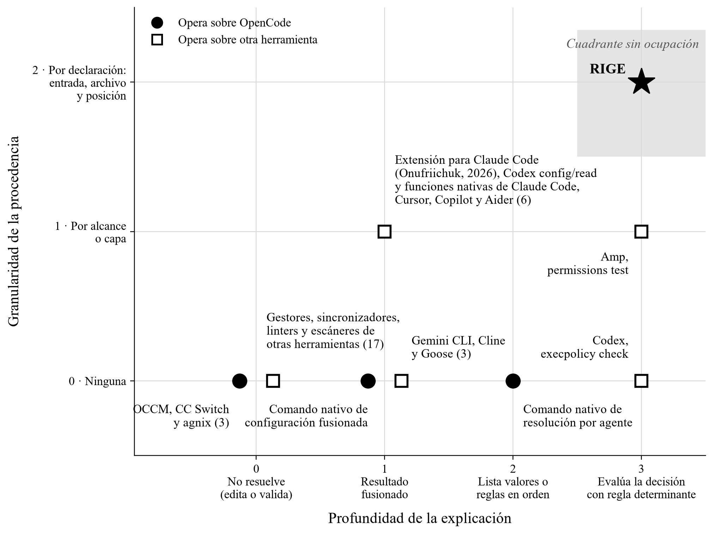

## IV.4 · Mapeo de competencia

El mapa compara competidores, soluciones de terceros, según la profundidad de la explicación de una decisión y la granularidad de su procedencia. Los ejes expresan el diferencial que combina la decisión con su regla determinante y la procedencia por declaración (Anexo III, D-59). Se descarta situar el diferencial solo en explicar la decisión porque Amp y Codex ya ofrecen esa función (apartado II.6.1, resultado 7).

El eje horizontal mide la profundidad de la explicación en cuatro niveles:

0. Declaraciones o validación, sin resolución del estado efectivo.
1. Resultado efectivo o fusionado.
2. Valores o reglas en orden de evaluación.
3. Decisión para una acción con su regla determinante.

El eje vertical mide la granularidad de la procedencia en tres niveles:

0. Sin procedencia.
1. Alcance o capa.
2. Declaración, con su entrada, archivo y posición.

Cada solución se ubica según las capacidades relevadas al 01/10/2026 mediante el contraste de documentación oficial, README y páginas de paquetes (Anexo VI, A.VI.4).

{width="5.625in" height="4.21875in"}

*Figura 2. Mapa de posicionamiento de las soluciones relevadas según la profundidad de la explicación y la granularidad de la procedencia. El círculo identifica soluciones sobre OpenCode y el cuadrado, sobre otras herramientas; las que comparten posición se agrupan con su cantidad. Fuente: elaboración propia sobre el relevamiento del 01/10/2026 (Anexo VI, A.VI.4).*

RIGE ocupa la celda de evaluación de la decisión con procedencia por declaración (3, 2). El relevamiento propio del 01/10/2026 no encontró esa combinación en las 33 soluciones publicadas incluidas en el contraste documental (Anexo VI, A.VI.4). Las más próximas son Amp, que evalúa la decisión con procedencia por alcance, y Codex `execpolicy check`, que evalúa comandos de shell sin archivo ni posición de la regla. Sobre OpenCode, el comando nativo de resolución por agente es el más próximo.

Los precedentes de dominios maduros quedan fuera del mapa por operar sobre otros dominios y se conservan como antecedentes de diseño (apartado IV.3). Los sincronizadores publicados se incluyen según sus capacidades documentadas. Los sustitutos, el agente con la skill `customize-opencode` (OpenCode, 2026), la prueba por comportamiento y la instrucción de probar, se analizan en el apartado IV.3 y quedan fuera de este mapa.

El precio se descarta como eje: se comprueban licencias libres en herramientas de terceros como OCCM y CC Switch; para otras soluciones, el relevamiento no encuentra el precio. La cobertura de herramientas discrimina en contra de RIGE y mide la amplitud de compatibilidad; la desventaja se declara en L-05 y en la visión del apartado IV.2.
