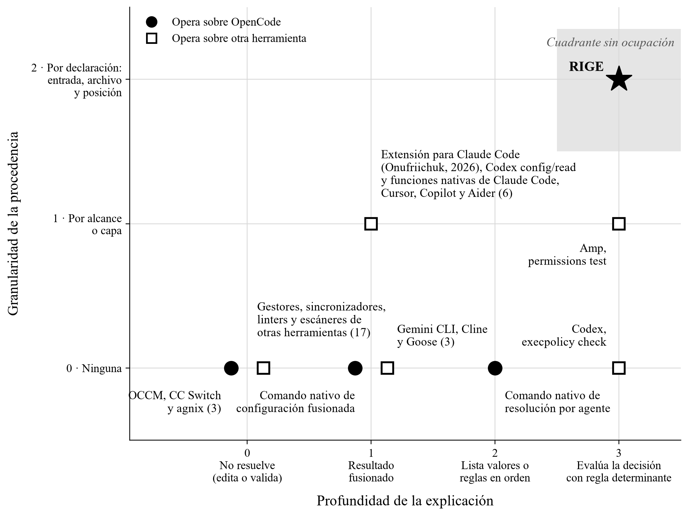

## IV.4 · Mapeo de competencia

El mapa compara alternativas relevadas, denominadas «competidores», sin presión competitiva verificada (apartado I.1.4). Los ejes se eligen después del relevamiento y expresan el diferencial provisorio de decisión con regla determinante y procedencia por declaración (Anexo III, D-59). Se descarta situar el diferencial solo en explicar la decisión porque Amp y Codex ya ofrecen esa función (apartado II.6.1, resultado 7).

El eje horizontal (H) mide la profundidad de la explicación en cuatro niveles:

0. Declaraciones o validación, sin resolución del estado efectivo.
1. Resultado efectivo o fusionado.
2. Valores o reglas en orden de evaluación.
3. Decisión para una acción con su regla determinante.

El eje vertical (V) mide la granularidad de la procedencia en tres niveles:

0. Sin procedencia.
1. Alcance o capa.
2. Declaración, con su entrada, archivo y posición.

El nivel horizontal se asigna por la salida documentada, desde declaraciones hasta decisión por acción con regla determinante. El nivel vertical exige acreditar el origen: alcance o capa para V=1, y entrada, archivo y posición de la declaración para V=2. Ese eje mide procedencia, que `build` resuelve sin error en la medición de atribución del autor del 13/10/2026, sobre 54 consultas de C-2 a C-4 con tres repeticiones por caso (Anexo I, A.I.2).

Cada solución se ubica según las capacidades relevadas al 01/10/2026 mediante el contraste de documentación oficial, README y páginas de paquetes (Anexo I, A.I.4). El autor produce la nómina con Codex como herramienta de apoyo para la búsqueda web y la clasificación documental. Las 33 soluciones del mapa constituyen un universo distinto de los 33 problemas de E2.

{width="5.625in" height="4.21875in"}

*Figura 2. Mapa de posicionamiento según explicación y procedencia. La posición de RIGE es prevista. El círculo identifica soluciones sobre OpenCode y el cuadrado, sobre otras herramientas; las posiciones compartidas se agrupan con su cantidad. Fuente: elaboración propia sobre el relevamiento del 01/10/2026 (Anexo I, A.I.4).*

La posición prevista de RIGE es la celda (3, 2), decisión con procedencia por declaración. El contraste documental del autor del 01/10/2026 deja esa combinación sin alternativa acreditada entre las 33 soluciones (Anexo I, A.I.4).

La lectura sobre OpenCode comprende cinco soluciones: `debug config`, `debug agent`, OCCM, CC Switch y agnix. Ninguna acredita la evaluación estática de una acción con la semántica real y su regla determinante. `debug agent --tool` ejecuta la herramienta; queda fuera del criterio de evaluación sin ejecutar (Anexo I, A.I.3). Para el problema vigente, la vacancia relevante reside en esa evaluación estática y el diagnóstico de declaraciones sin efecto, por verificar en RIGE.

Las otras 28 soluciones operan sobre herramientas distintas y no son elegibles para ese usuario de OpenCode sin cambiar de herramienta. Amp evalúa la decisión con procedencia por alcance; Codex `execpolicy check` evalúa comandos de shell sin archivo ni posición de la regla. Su proximidad técnica describe similitud funcional; la presión competitiva sobre el uso delimitado se desconoce.

Claude Code Config Manager navega a la línea JSON de la declaración (Onufriichuk, 2026). Su V=1 es una lectura conservadora: esa navegación lo aproxima a V=2 para valores. La evaluación de decisiones con regla determinante queda fuera de su cobertura y conserva la vacancia en H=3 (Anexo I, A.I.4).

Una solución sobre OpenCode que informe decisión y declaración determinante, o un sustituto que iguale el diagnóstico, invalida la vacancia atribuida a RIGE. El lugar previsto queda sujeto a esa condición de refutación.

Los precedentes de dominios maduros quedan fuera del mapa por operar sobre otros dominios y se conservan como antecedentes de diseño (apartado IV.3). Los sincronizadores publicados se incluyen según sus capacidades documentadas. El agente con la skill `customize-opencode` (OpenCode, 2026) y las instrucciones de probar o de usar rutas relativas se analizan como sustitutos en IV.3. La prueba por comportamiento corresponde a la instrucción de probar.

El precio se descarta como eje: se comprueban licencias libres en herramientas de terceros como OCCM y CC Switch; para otras soluciones, el relevamiento no encuentra el precio. La cobertura de herramientas discrimina en contra de RIGE y mide la amplitud de compatibilidad; la desventaja se declara en L-05 y en la visión del apartado IV.2.
