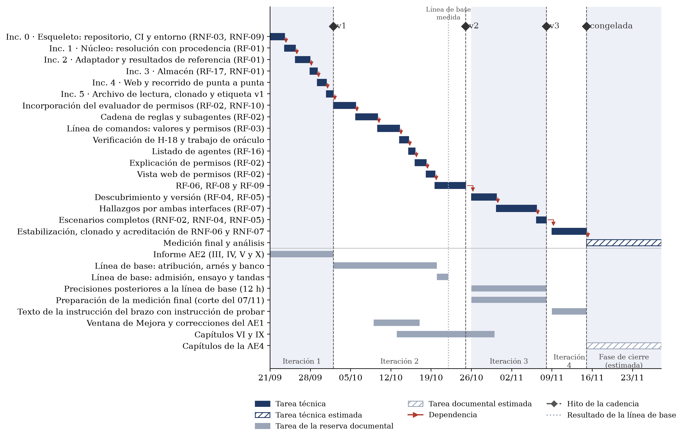

## V.4 · Cronograma

### Presupuesto de horas-persona

El presupuesto se construye sobre las horas semanales declaradas en el Instrumento 24. La capacidad técnica determina los requisitos Must del período y la reserva financia los capítulos, las correcciones y la preparación de las mediciones, con entregables de fecha fija. La reserva se mantiene separada de los requisitos y del margen de contingencia. La reducción prevista del 15 % por exámenes y feriados del período y su distribución proporcional entre las iteraciones constituyen supuestos de planificación, sin registro de fechas que los respalde.

| **Presupuesto de horas-persona**                 | **Valor declarado**                                                                      |
|--------------------------------------------------|------------------------------------------------------------------------------------------|
| Integrantes del equipo                           | 1, de autoría individual                                                                 |
| Horas semanales reales por integrante            | 28 h: 20 técnicas y 8 de reserva documental y de validación                                              |
| Presupuesto total del período                    | 224 h en ocho semanas, del 21/09 al 14/11/2026: 160 técnicas y 64 de reserva             |
| Reducción prevista de disponibilidad          | 15 %, equivalente a 34 h: 24 técnicas y 10 de reserva                                    |
| **Presupuesto efectivo resultante**              | **190 h: 136 técnicas y 54 de reserva**                                                  |
| Fase de cierre posterior al período (estimación) | 48 h efectivas en las semanas 15 y 16, sujetas a la confirmación de las fechas de la AE4 |

*Tabla 14. Presupuesto de horas-persona del proyecto. Fuente: elaboración propia sobre el Instrumento 24.*

### Asignación por iteración

| **Iteración** | **Días** | **Capacidad efectiva (h)** | **Horas asignadas (h)** | **Diferencia (h)** |
|---|---|---|---|---|
| 1 | 11 | 28 | 35 | +7 |
| 2 | 23 | 59 | 60 | +1 |
| 3 | 13 | 33 | 30 | −3 |
| 4 | 6 | 16 | 11 | −5 |
| **Total** | **53** | **136** | **136** | **0** |

*Tabla 15. Asignación de las horas técnicas por iteración, con la capacidad efectiva y la diferencia. Fuente: elaboración propia sobre el Instrumento 24.*

Nota: el reparto de 136 h entre los 53 días redondea las 15,4 h de la cuarta iteración a 16 h para conservar el total. El cómputo excluye los domingos 25/10 y 08/11/2026 entre iteraciones.

Las iteraciones 1 y 2 exceden su capacidad en 7 h y 1 h, respectivamente. La holgura de las dos últimas compensa las 8 h en el total del período, pero queda después de los primeros hitos. El traslado de 7 h a la segunda iteración supera el umbral de 6 h que activa la contingencia de ADR-052, sin activación registrada. El recorrido vertical del v1 se completa en esa iteración (apartado V.2).

La dedicación efectiva queda por contrastar con el plan: [DATO PENDIENTE: registro de dedicación por iteración].

La reserva efectiva asigna 14 h a la AE2 y 20 h a la Ventana de Mejora y Cumplimiento y las correcciones del informe de la AE1. Se destinan 13 h a los Capítulos VI y IX; el resto de la reserva cubre la preparación de la medición final, detallada debajo. La estimación de la línea de base, de 16 a 23 h, se carga a la Ventana (Anexo III, D-41). Su cota alta excede por 3 h las 20 h de esa reserva, aun antes de las correcciones del informe.

Las 54 h de reserva tienen asignación completa. La estimación del ingeniero del 24/10/2026 agrega 12 h de precisiones que quedan fuera de ese reparto. El plan conserva 190 h; sin absorción registrada, la previsión asciende a 202 h. El desvío agrega $106.512 (USD 68,94), todavía sin imputar en la Tabla 22 de costos de X.3; allí constan el valor horario y el factor de conversión.

La preparación de la medición final se estima en 10 h: 7 h de reserva entre el 26/10 y el 14/11/2026 y 3 h de la fase de cierre desde el 15/11. La Figura 3 representa del 26/10 al 07/11 la preparación de escenarios y remuestreo, y del 09/11 al 14/11 la fijación del texto de la instrucción. La preparación del cierre integra la barra de medición final y análisis.

Antes del corte del 07/11/2026, la preparación comprende:

- Admisión nativa, readmisión y ensayo del conjunto reservado.

- Corrección de las formas de referencia defectuosas, con readmisión y ensayo; los casos se identifican en el Anexo VI, A.VI.8.

- Remuestreo de las condiciones de no regresión.

- Incorporación al manifiesto de los escenarios de CA-9 de RF-02 y del defecto de RF-07, CA-5.

El texto de la instrucción del brazo con instrucción de probar se fija antes del congelamiento planificado del 14/11/2026 (Anexo III, D-41).

La fase de cierre se estima en dos semanas según la correspondencia de clases de la consigna. Sus 48 h se desglosan en 15 h para la medición final y su análisis, incluida la preparación, y 24 h para los capítulos de la AE4. Se asignan 5 h a la constancia de la referente y la demostración, y 4 h a holgura. Este presupuesto queda sujeto a la confirmación de las fechas de la cuarta actividad de evaluación; un cambio de fechas altera esa línea y mantiene el alcance comprometido.

### Estimación por tareas

La estimación descompone cada iteración en tareas y les asigna horas por juicio del autor, sobre la base de su experiencia en desarrollo de software (Cohn, 2005). La Tabla 16 asigna las 136 h técnicas a los requisitos Must y a la estabilización prevista en la Tabla 11 del apartado V.1. La estimación precede a la adopción, el 30/09/2026, de una herramienta de inteligencia artificial como apoyo a la escritura del código sobre fichas del autor (Anexo III). Las horas cubren la especificación, la revisión y la verificación de cada tarea. Su suficiencia se controla mediante el registro de horas de la segunda iteración.

| **Iteración** | **Tarea**                                                                           | **Requisitos**                              | **Horas** |
|---------------|-------------------------------------------------------------------------------------|---------------------------------------------|-----------|
| 1 | Incremento 0 · Esqueleto: repositorio, canal de integración continua y entorno | Condición (a) de la definición de terminado; RNF-03, RNF-09 | 8 |
| 1 | Incremento 1 · Núcleo: resolución con procedencia conforme a RD-01 | RF-01, RNF-03 | 6 |
| 1 | Incremento 2 · Adaptador: lectura de tres entradas de archivo con su posición, y primeros resultados de referencia | RF-01 | 8 |
| 1 | Incremento 3 · Almacén propio: esquema, escritura y lectura de la resolución | RF-17, RNF-01 | 4 |
| 1 | Incremento 4 · Interfaz web y recorrido de punta a punta | RF-01, RF-17 | 5 |
| 1 | Incremento 5 · Archivo de lectura, prueba de clonado y etiqueta v1 | Condición de aceptación del v1 (apartado V.2) | 4 |
|               | **Subtotal de la iteración 1**                                                      |                                             | **35**    |
| 2             | Incorporación del evaluador de permisos de OpenCode, con atribución                 | RF-02, RNF-10                               | 10        |
| 2             | Cadena ordenada de reglas y reglas propias de los subagentes conforme a RD-03 y RD-05      | RF-02                                       | 10        |
| 2             | Valores implícitos y reglas nativas                                                 | RF-06                                       | 6         |
| 2             | Comando compuesto y protección nativa desactivada                                   | RF-08, RF-09                                | 8         |
| 2             | Explicación mediante plantillas deterministas                                       | RF-02                                       | 5         |
| 2             | Vista web de consulta de permiso                                                    | RF-02                                       | 4         |
| 2             | Salida por línea de comandos: valores y decisiones de permiso, con esquema versionado y explicación a pedido | RF-03                              | 10        |
| 2             | Verificación de H-18 y trabajo de oráculo, incluida la regeneración automática de los resultados de referencia | RNF-02                   | 4         |
| 2             | Listado de los agentes declarados y nativos, por ambas interfaces                   | RF-16                                       | 3         |
|               | **Subtotal de la iteración 2**                                                      |                                             | **60**    |
| 3             | Descubrimiento de las entradas aplicables y de su legibilidad                       | RF-04                                       | 8         |
| 3             | Advertencia ante una versión distinta                                               | RF-05                                       | 2         |
| 3             | Seis tipos de hallazgo con su explicación                                           | RF-07                                       | 12        |
| 3             | Conjunto completo de escenarios y verificaciones de seguridad                       | RNF-02, RNF-04, RNF-05                      | 4         |
| 3             | Vista web y salida por línea de comandos de los hallazgos                           | RF-07                                       | 4         |
|               | **Subtotal de la iteración 3**                                                      |                                             | **30**    |
| 4             | Corrección de defectos, regresión completa, prueba de clonado y archivo de lectura; acreditación de RNF-06 y RNF-07 | Requisitos Must; RNF-06 y RNF-07 | 11        |
|               | **Total de la capacidad técnica efectiva**                                          |                                             | **136**   |

*Tabla 16. Estimación de horas por tarea e iteración. Fuente: elaboración propia.*

Nota: la estimación del ingeniero del 24/10/2026 agrega las siguientes tareas a las previstas al 02/10:

- Precisiones de la normalización de rutas y de la forma que coincide, verificadas contra el binario (RF-02, CA-9; RF-07, CA-5).

- Salida de hallazgos por línea de comandos, representación pública de sustituciones, consulta de decisión medida y regla del sujeto relativo (RF-03, RNF-04, RNF-07 y RD-08). Junto con las anteriores, se estiman en 12 h adicionales al presupuesto.

- Preparación de la medición final, según las tareas y la distribución de horas indicadas antes de la tabla.

Los seis requisitos Should se financian con las horas que quedan libres al cierre de cada iteración o con las acreditaciones previstas dentro de la estabilización. Los cambios de iteración, la precisión de rutas y la verificación de agentes internos se detallan en V.1, con evidencia en el Anexo VI, A.VI.11.

Las comprobaciones de RNF-06 y RNF-07 se planifican dentro de las 11 h de estabilización y se postergan primero si esta se reduce. Su resultado registrado consta en V.2.

### Cronograma y dependencias

{width="6.2in"}

*Figura 3. Cronograma del proyecto con dependencias entre tareas consecutivas y los hitos de la cadencia, según las tareas de la Tabla 16. La iteración 1 se presenta por los incrementos con que se construye el v1. Las barras rayadas corresponden a la fase de cierre, cuya duración se estima. Fuente: elaboración propia sobre la Tabla 16.*

La ruta crítica enlaza las tareas de cada iteración:

- Primera: incrementos 0 a 5.

- Segunda: evaluador, cadena de reglas, línea de comandos, H-18, RF-16 y capacidades restantes de permisos.

- Tercera: descubrimiento y versión, hallazgos y escenarios completos.

- Cuarta: estabilización.

La figura omite tres dependencias no consecutivas: núcleo → hallazgos, cadena de reglas → hallazgos y cadena de reglas → RF-06. El orden de construcción derivado de la línea de base y la ejecución de esta se describen en el apartado V.1.

### Cláusula de contingencia

La cláusula de contingencia toma como base las 136 h técnicas: un tercio equivale a 45 h redondeadas y deja 91 h. La Tabla 17 libera esas 45 h mediante postergaciones en el orden indicado. La exigencia (vii) de la consigna se refiere a un tercio del presupuesto: sobre las 190 h serían 63 h redondeadas. Las 18 h restantes quedan sin cobertura definida. La reserva financia entregables de fecha fija y conserva su asignación (Anexo III, D-38 a D-40).

| **Orden** | **Qué se posterga**                                                                                                       | **Horas liberadas** | **Acumulado** |
|-----------|---------------------------------------------------------------------------------------------------------------------------|---------------------|---------------|
| 1         | Requisitos Should RF-10, RF-11, RF-12 y RNF-08, sin horas propias. Acreditaciones de RNF-06 en Windows 11 y de RNF-07, incluidas en las 11 h de estabilización. Su reducción se computa en el orden 7 | 0 | 0 |
| 2         | Regeneración automática de los resultados de referencia, sustituida por una regeneración manual registrada en la bitácora | 2                   | 2             |
| 3         | Vista web de consulta de permiso. La decisión se conserva por línea de comandos. Se incumple la parte de RF-02 y RF-03 que exige coincidencia con la interfaz web | 4                   | 6             |
| 4         | Explicación en lenguaje natural de las decisiones de permiso, mediante plantillas de RF-02 y explicación a pedido         | 5                   | 11            |
| 5         | RF-04 · descubrimiento completo, que sale del MVP; se conservan las entradas de archivo del v1 | 8 | 19 |
| 6         | RF-07 · hallazgos, con su vista web y su salida por línea de comandos (CU-04). Sale del MVP y deja incompleto el flujo de verificación | 16 | 35 |
| 7         | Estabilización, reducida de 11 h a 1 h                                                                                    | 10                  | 45            |

*Tabla 17. Cláusula de contingencia ante una caída de un tercio de la capacidad técnica. Fuente: elaboración propia sobre la Tabla 16.*

Se postergan primero las capacidades ajenas a la medición final y a la mitigación del riesgo principal. Entre ellas, se difiere antes la que menos debilita un objetivo específico. Al activarse la contingencia, se redefine el MVP y se actualiza el catálogo: los Must postergados salen del conjunto comprometido. Las postergaciones constan en la bitácora y el tablero. El efecto de cada orden sobre los objetivos específicos consta en el Anexo III, A.III.3.

El orden 6 retira RF-07 del MVP y deja incompleto el flujo de verificación: conserva la consulta de decisión y pierde el diagnóstico de la regla sin efecto. Su postergación deja sin acreditar OE-3 y sin evaluar la condición de detección. La cobertura de los problemas se revisa antes del corte del 07/11/2026; con menos de tres cubiertos se activa la rama de respaldo, según sus condiciones de detección y falsos positivos (apartado I.3.4).

Se conservan en todos los órdenes:

- La trazabilidad del catálogo y la ejecutabilidad de cada etiqueta, condiciones de cómputo de la cátedra.

- La fidelidad respecto de OpenCode 1.18.25 (RNF-02), que mitiga el riesgo principal.

- La seguridad de RNF-01, RNF-04 y RNF-05.

- Los casos mínimos de análisis con advertencia de versión, consulta de valores y consulta de permisos definidos en la Tabla 18 (apartado V.5).

- La decisión de RF-02, incluido CA-9, con RF-06, RF-08 y RF-09; su explicación en prosa queda sujeta al orden 4.

- RF-03 para consultar valores y permisos por línea de comandos, canal de la medición final.

Estas capacidades sostienen la consulta del flujo de valor del apartado IV.3; su verificación completa requiere conservar los hallazgos.
