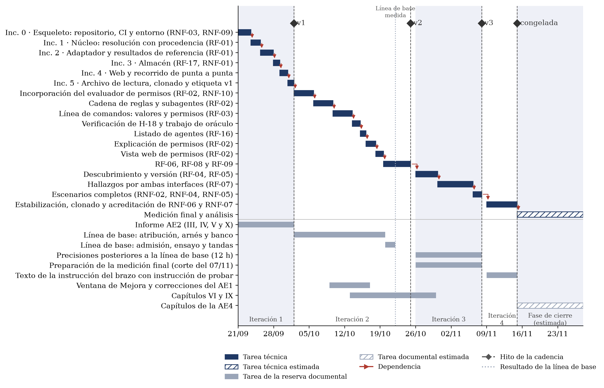

## V.4 · Cronograma

### Presupuesto de horas-persona

El presupuesto se construye sobre las horas semanales declaradas en el Instrumento 24. La capacidad técnica determina los requisitos Must del período y la reserva financia los capítulos, las correcciones y la preparación de las mediciones, con entregables de fecha fija. La reserva se mantiene separada de los requisitos y del margen de contingencia. La reducción prevista del 15 % por exámenes y feriados del período y su distribución proporcional entre las iteraciones constituyen supuestos de planificación, sin registro de fechas que los respalde.

| **Presupuesto de horas-persona**                 | **Valor declarado**                                                                      |
|--------------------------------------------------|------------------------------------------------------------------------------------------|
| Integrantes del equipo                           | 1, de autoría individual                                                                 |
| Horas semanales reales por integrante            | 28 h: 20 técnicas y 8 de reserva documental y de validación                                              |
| Presupuesto total del período                    | 224 h en ocho semanas, del 21/09 al 14/11/2026: 160 técnicas y 64 de reserva             |
| Reducción prevista de disponibilidad          | 15 %, equivalente a 34 h: 24 técnicas y 10 de reserva                                    |
| **Presupuesto efectivo resultante**              | **190 h: 136 técnicas y 54 de reserva**                                                  |
| Fase de cierre posterior al período (estimación) | 48 h efectivas en las semanas 15 y 16, sujetas a la confirmación de las fechas de la AE4 |

*Tabla 14. Presupuesto de horas-persona del proyecto. Fuente: elaboración propia sobre el Instrumento 24.*

### Asignación por iteración

| **Iteración** | **Días** | **Capacidad efectiva (h)** | **Horas asignadas (h)** | **Diferencia (h)** |
|---|---|---|---|---|
| 1 | 11 | 28 | 35 | +7 |
| 2 | 23 | 59 | 60 | +1 |
| 3 | 13 | 33 | 30 | −3 |
| 4 | 6 | 16 | 11 | −5 |
| **Total** | **53** | **136** | **136** | **0** |

*Tabla 15. Asignación de las horas técnicas por iteración, con la capacidad efectiva y la diferencia. Fuente: elaboración propia sobre el Instrumento 24.*

Nota: el reparto de 136 h entre los 53 días redondea las 15,4 h de la cuarta iteración a 16 h para conservar el total. El cómputo excluye los domingos 25/10 y 08/11/2026 entre iteraciones.

Las dos primeras iteraciones se planifican con 8 h por encima de su capacidad, que la holgura de las dos últimas compensa en el total del período, pero no antes del hito de la primera. Ese exceso se traslada a la segunda iteración, en la que se completa el recorrido vertical del v1 (apartado V.2).

La reserva efectiva asigna 14 h a la AE2 y 20 h a la Ventana de Mejora y Cumplimiento y las correcciones del informe de la AE1. Se destinan 13 h a los Capítulos VI y IX y 7 h a la preparación de la medición final. La estimación de la línea de base, de 16 a 23 h, se carga a la Ventana (Anexo III, D-41).

El trabajo agregado después del 02/10/2026 se absorbe en la reserva existente, según la estimación del ingeniero del 24/10/2026 que acompaña a la Tabla 16. Las precisiones de requisitos insumen 12 h de la reserva de la iteración 3. La preparación de la medición final se estima en 10 h, con 7 h de la reserva de la iteración 4 y 3 h de la fase de cierre. Las 190 h del período se conservan.

Antes del corte del 07/11/2026, la preparación comprende:

- Admisión nativa, readmisión y ensayo del conjunto reservado.

- Corrección de las formas de referencia de S-3 y M-2, con readmisión y ensayo.

- Remuestreo de las condiciones de no regresión.

- Incorporación al manifiesto de los escenarios de CA-9 de RF-02 y del defecto de RF-07, CA-5.

El texto de la instrucción del brazo con instrucción de probar se fija antes del congelamiento del 14/11/2026 (Anexo III, D-41).

La fase de cierre se estima en dos semanas según la correspondencia de clases de la consigna. Sus 48 h se desglosan en 15 h para la medición final y su análisis, incluidas las 3 h de preparación, y 24 h para los capítulos de la AE4. Se asignan 5 h a la constancia de la referente y la demostración, y 4 h a holgura. Este presupuesto queda sujeto a la confirmación de las fechas de la cuarta actividad de evaluación; un cambio de fechas altera esa línea y mantiene el alcance comprometido.

### Estimación por tareas

La estimación descompone cada iteración en tareas y les asigna horas por juicio del autor, sobre la base de su experiencia en desarrollo de software (Cohn, 2005). La Tabla 16 asigna las 136 h técnicas a los requisitos Must y a la estabilización prevista en la Tabla 11 del apartado V.1. La estimación precede a la adopción, el 30/09/2026, de una herramienta de inteligencia artificial como apoyo a la escritura del código sobre fichas del autor (Anexo III). Las horas cubren la especificación, la revisión y la verificación de cada tarea. Su suficiencia se controla mediante el registro de horas de la segunda iteración.

| **Iteración** | **Tarea**                                                                           | **Requisitos**                              | **Horas** |
|---------------|-------------------------------------------------------------------------------------|---------------------------------------------|-----------|
| 1 | Incremento 0 · Esqueleto: repositorio, canal de integración continua y entorno | Condición (a) de la definición de terminado; RNF-03, RNF-09 | 8 |
| 1 | Incremento 1 · Núcleo: resolución con procedencia conforme a RD-01 | RF-01, RNF-03 | 6 |
| 1 | Incremento 2 · Adaptador: lectura de tres entradas de archivo con su posición, y primeros resultados de referencia | RF-01 | 8 |
| 1 | Incremento 3 · Almacén propio: esquema, escritura y lectura de la resolución | RF-17, RNF-01 | 4 |
| 1 | Incremento 4 · Interfaz web y recorrido de punta a punta | RF-01, RF-17 | 5 |
| 1 | Incremento 5 · Archivo de lectura, prueba de clonado y etiqueta v1 | Condición de aceptación del v1 (apartado V.2) | 4 |
|               | **Subtotal de la iteración 1**                                                      |                                             | **35**    |
| 2             | Incorporación del evaluador de permisos de OpenCode, con atribución                 | RF-02, RNF-10                               | 10        |
| 2             | Cadena ordenada de reglas y reglas propias de los subagentes conforme a RD-03 y RD-05      | RF-02                                       | 10        |
| 2             | Valores implícitos y reglas nativas                                                 | RF-06                                       | 6         |
| 2             | Comando compuesto y protección nativa desactivada                                   | RF-08, RF-09                                | 8         |
| 2             | Explicación mediante plantillas deterministas                                       | RF-02                                       | 5         |
| 2             | Vista web de consulta de permiso                                                    | RF-02                                       | 4         |
| 2             | Salida por línea de comandos: valores y decisiones de permiso, con esquema versionado y explicación a pedido | RF-03                              | 10        |
| 2             | Verificación de H-18 y trabajo de oráculo, incluida la regeneración automática de los resultados de referencia | RNF-02                   | 4         |
| 2             | Listado de los agentes declarados y nativos, por ambas interfaces                   | RF-16                                       | 3         |
|               | **Subtotal de la iteración 2**                                                      |                                             | **60**    |
| 3             | Descubrimiento de las entradas aplicables y de su legibilidad                       | RF-04                                       | 8         |
| 3             | Advertencia ante una versión distinta                                               | RF-05                                       | 2         |
| 3             | Seis tipos de hallazgo con su explicación                                           | RF-07                                       | 12        |
| 3             | Conjunto completo de escenarios y verificaciones de seguridad                       | RNF-02, RNF-04, RNF-05                      | 4         |
| 3             | Vista web y salida por línea de comandos de los hallazgos                           | RF-07                                       | 4         |
|               | **Subtotal de la iteración 3**                                                      |                                             | **30**    |
| 4             | Corrección de defectos, regresión completa, prueba de clonado y archivo de lectura; acreditación de RNF-06 y RNF-07 | Requisitos Must; RNF-06 y RNF-07 | 11        |
|               | **Total de la capacidad técnica efectiva**                                          |                                             | **136**   |

*Tabla 16. Estimación de horas por tarea e iteración. Fuente: elaboración propia.*

Nota: la estimación del ingeniero del 24/10/2026 agrega las siguientes tareas a las previstas al 02/10, con cargo a la reserva y al cierre:

- Precisiones de RF-02, CA-9, por tipo de permiso y contra el binario; RF-07, CA-5; y RF-03 con hallazgos: junto con las precisiones siguientes, 12 h de la reserva de la iteración 3.

- Precisiones de RNF-04, RNF-07 con la consulta de decisión y RD-08, incluidas en esas 12 h.

- Preparación de la medición final: 10 h, con 7 h de la reserva de la iteración 4 y 3 h del cierre, según las tareas y fechas indicadas antes de la tabla.

Los seis requisitos Should se financian con las horas que quedan libres al cierre de cada iteración o con las acreditaciones previstas dentro de la estabilización. RF-12 se incorpora en la segunda iteración, condicionado a las horas disponibles. RF-10, RF-11 y RNF-08 se incorporan en la tercera bajo la misma condición. La acreditación de RNF-06 y RNF-07 sigue lo previsto para las 11 h de estabilización en el apartado V.1 y es lo primero que se posterga si esta se reduce.

### Cronograma y dependencias

{width="6.2in"}

*Figura 3. Cronograma del proyecto con dependencias entre tareas consecutivas y los hitos de la cadencia, según las tareas de la Tabla 16. La iteración 1 se presenta por los incrementos con que se construye el v1. Las barras rayadas corresponden a la fase de cierre, cuya duración se estima. Fuente: elaboración propia sobre la Tabla 16.*

La ruta crítica enlaza las tareas de cada iteración:

- Primera: incrementos 0 a 5.

- Segunda: evaluador, cadena de reglas, línea de comandos, H-18, RF-16 y capacidades restantes de permisos.

- Tercera: descubrimiento y versión, hallazgos y escenarios completos.

- Cuarta: estabilización.

La figura omite tres dependencias no consecutivas: núcleo → hallazgos, cadena de reglas → hallazgos y cadena de reglas → RF-06. El orden de construcción derivado de la línea de base y la ejecución de esta se describen en el apartado V.1.

### Cláusula de contingencia

La cláusula de contingencia opera sobre la capacidad técnica, que es la que determina los requisitos comprometidos. La magnitud de la caída, un tercio del presupuesto, la fija la consigna de la AE2 en su exigencia (vii). Esa caída reduce las 136 h a 91 h, y la pérdida de 45 h se absorbe mediante las postergaciones de la Tabla 17, aplicadas en el orden indicado hasta cubrirla. La consigna fija la caída sobre el presupuesto; se aplica a la capacidad técnica porque la reserva financia entregables de fecha fija (capítulos, Ventana y Caps. VI y IX), que no admiten postergación sin perder el hito.

| **Orden** | **Qué se posterga**                                                                                                       | **Horas liberadas** | **Acumulado** |
|-----------|---------------------------------------------------------------------------------------------------------------------------|---------------------|---------------|
| 1         | Requisitos Should RF-10, RF-11, RF-12 y RNF-08, sin horas propias; acreditaciones de RNF-06 en Windows 11 y de RNF-07, incluidas en las 11 h de estabilización, cuya reducción se computa en el orden 7 | 0 | 0 |
| 2         | Regeneración automática de los resultados de referencia, sustituida por una regeneración manual registrada en la bitácora | 2                   | 2             |
| 3         | Vista web de consulta de permiso; la decisión se conserva por línea de comandos; la parte de los criterios de RF-02 y RF-03 que exige coincidencia con la interfaz web queda sin cumplir | 4                   | 6             |
| 4         | Explicación en lenguaje natural de las decisiones de permiso, mediante plantillas de RF-02 y explicación a pedido         | 5                   | 11            |
| 5         | RF-04 · descubrimiento completo; se conservan las entradas de archivo del v1                                              | 8                   | 19            |
| 6         | RF-07 · hallazgos, con su vista web y su salida por línea de comandos (CU-04)                                             | 16                  | 35            |
| 7         | Estabilización, reducida de 11 h a 1 h                                                                                    | 10                  | 45            |

*Tabla 17. Cláusula de contingencia ante una caída de un tercio de la capacidad técnica. Fuente: elaboración propia sobre la Tabla 16.*

Se postergan primero las capacidades ajenas a la medición final y a la mitigación del riesgo principal. Entre ellas, se difiere antes la que menos debilita un objetivo específico. Las postergaciones se registran en la bitácora y el tablero y se reflejan en la prioridad del catálogo y, si afectan un Must, en el producto mínimo viable del apartado V.5. El efecto de cada orden sobre los objetivos específicos consta en el Anexo III, A.III.3.

El orden 6 alcanza a RF-07, que interviene en la medición final y en el diagnóstico de la regla sin efecto. Su postergación deja sin acreditar OE-3 y sin evaluar la condición de detección. La cobertura de los problemas se revisa antes del corte del 07/11/2026; con menos de tres cubiertos se activa la rama de respaldo, según sus condiciones de detección y falsos positivos (apartado I.3.4).

Se conservan en todos los órdenes:

- La trazabilidad del catálogo y la ejecutabilidad de cada etiqueta, condiciones de cómputo de la cátedra.

- La fidelidad respecto de OpenCode 1.18.25 (RNF-02), que mitiga el riesgo principal.

- La seguridad de RNF-01, RNF-04 y RNF-05.

- Los casos mínimos de análisis con advertencia de versión, consulta de valores y consulta de permisos definidos en la Tabla 18 (apartado V.5).

- La decisión de RF-02, incluido CA-9, con RF-06, RF-08 y RF-09; su explicación en prosa queda sujeta al orden 4.

- RF-03 para consultar valores y permisos por línea de comandos, canal de la medición final.

Estas capacidades sostienen el flujo de valor del apartado IV.3.
