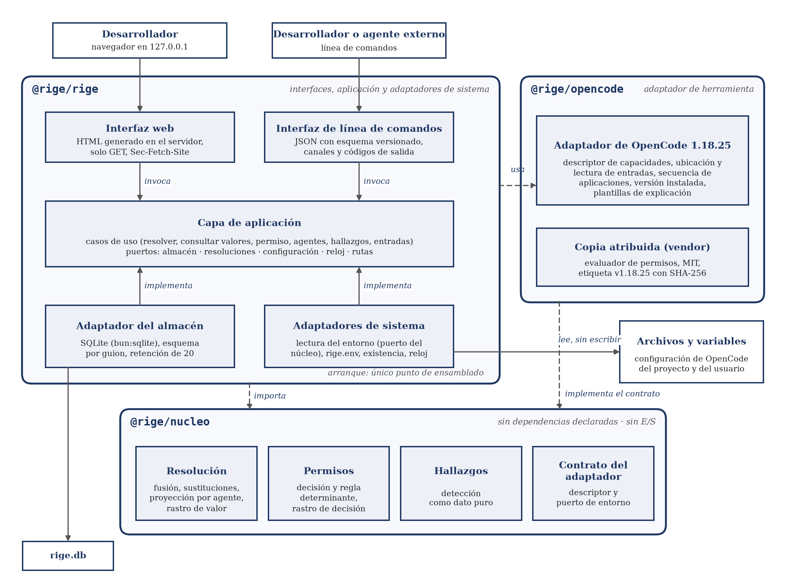

## IX.1 · Arquitectura adoptada y matriz de decisión ponderada

### IX.1.1 · Arquitectura adoptada

RIGE adopta puertos y adaptadores, con un núcleo sin entrada ni salida y sin dependencias declaradas. La estructura comprende tres paquetes aislados, `nucleo`, `opencode` y `rige`, con un único punto de ensamblado que conecta las implementaciones con sus puertos (ADR-058). La Figura IX.1 muestra esta estructura.

*Figura IX.1. Arquitectura de RIGE: puertos y adaptadores en tres paquetes aislados. Las flechas discontinuas son dependencias de compilación permitidas. Fuente: elaboración propia.*

El núcleo opera sobre los conceptos del modelo del dominio (III.2, Figura 1). Cada parte asume las siguientes funciones:

- Núcleo: ejecuta la resolución genérica, con fusión, sustituciones, proyección por agente y rastro de valor. Obtiene la decisión de permiso, su regla determinante y su rastro de decisión, y detecta hallazgos como datos puros. Define el contrato del adaptador, con el descriptor de capacidades y el puerto de lectura del entorno, sin identificar la herramienta, conforme a RNF-03 (ADR-060).

- Adaptador de OpenCode: declara la secuencia de aplicaciones y sus estrategias, ubica y lee las entradas a través del puerto del núcleo y detecta la versión instalada sin ejecutarla. Aporta el evaluador de permisos copiado de la versión 1.18.25 con atribución.

- Capa de aplicación: coordina los casos de uso, escritos una sola vez e invocados por ambas interfaces. Compartir los casos de uso sostiene la paridad de resultados que exigen OE-1 y OE-2 sobre las consultas que presenta la web (I.2.4).

- Adaptadores de sistema: implementan el almacén SQLite, la lectura del entorno, la configuración propia y el reloj. Estas implementaciones concentran el acceso al disco.

- Interfaces: la línea de comandos entrega JSON validado contra un esquema versionado, con canales y códigos de salida definidos. La web local escucha en `127.0.0.1`, genera el HTML en el servidor y ofrece solo consultas.

La dependencia prohibida entre paquetes falla en compilación. Las guardas de arquitectura usan un analizador léxico propio para verificar además las reglas de dependencia, la ausencia de clientes de red y de identificaciones de la herramienta en el núcleo (ADR-070).

RNF-01, RNF-04 y RNF-05 se concretan en los puertos, los tipos y las pruebas. El puerto de lectura ofrece solo operaciones de lectura sobre las entradas. El contenido incorporado por sustitución se representa con un tipo opaco, cuyos serializadores exponen solo el origen y la condición. Las pruebas prohíben los módulos de red y hacen fallar los intentos de conexión saliente (ADR-058).

Los defectos de la configuración se representan como hallazgos, y los errores de uso, como valores tipados. Las fallas de infraestructura y los defectos internos producen excepciones capturadas una sola vez en el borde de cada interfaz (ADR-058). Los errores del entorno corregibles mediante una variable y detectables antes de operar se clasifican como errores de uso (ADR-069). La explicación en prosa de permisos y hallazgos se obtiene de plantillas deterministas aportadas por el adaptador sobre sus datos y rastros (ADR-051 y ADR-105).

Esta separación admite otra herramienta mediante un adaptador nuevo, escrito contra el contrato del núcleo, sin modificarlo. El adaptador ficticio de la prueba de RNF-03 comprueba esa frontera. Las versiones y los costos de los recursos tecnológicos constan en X.4.

La readaptación a otra versión de OpenCode, lo primero que cede en el negocio (Cap. XI), se concentra en el paquete del adaptador: copia del evaluador, agentes nativos, versión exigida por RF-05 y referencias. La medida técnica para `hallazgos` del Instrumento 39, perfilar y sustituir las búsquedas lineales por un índice por agente y sujeto, se aplica dentro del núcleo sin cambiar su contrato.

### IX.1.2 · Matriz de decisión ponderada

Las matrices formalizan decisiones tomadas mediante análisis cualitativo: el entorno de ejecución se decide el 25/09/2026 y la arquitectura, el 29/09/2026. La ponderación del 08/11/2026 es posterior a esas decisiones. Se adoptan cuatro controles: criterios y pesos registrados antes de puntuar, fuente de cada puntaje, sensibilidad de los pesos y cantidad de puntos que falta a cada alternativa perdedora para alcanzar a la ganadora.

El ganador ya se conoce al fijar los pesos. El orden entre pesos y puntajes no se puede verificar por terceros, porque ambos se registran el mismo día. Los puntajes derivan de análisis que fundamentan las decisiones y pueden heredar su sesgo. La regla de veto se acota a la fidelidad después de puntuar, sin efecto en los resultados.

La escala va de 1 a 5 en sentido favorable; gana el índice mayor y un puntaje 1 en fidelidad veta la alternativa. El índice es la suma de los productos de cada peso por su puntaje, dividida por 100. Se toma la forma del Instrumento 37 y se adoptan criterios propios, porque los de la cátedra se orientan a una tecnología emergente (Anexo III, D-74). La Tabla IX.1 reúne los criterios y sus pesos.

| **Criterio** | **Peso (%)** | **Qué se evalúa** | **Origen** | **Característica (ISO/IEC 25010:2023)** |
|---|---|---|---|---|
| C1 Fidelidad a OpenCode 1.18.25 | 30 | Coincidencia con la herramienta sin reimplementar su semántica | OE-1; riesgo principal (I.3.5) | Adecuación funcional (corrección funcional) |
| C2 Aislamiento del núcleo | 20 | Independencia del núcleo respecto del adaptador y de la infraestructura, con detección automática de la violación por compilación o pruebas | RNF-03 | Mantenibilidad (modularidad y modificabilidad) |
| C3 Ejecutabilidad en una máquina ajena | 20 | Prerrequisitos para instalar, construir y ejecutar | Guía de comprobación | Flexibilidad (instalabilidad) |
| C4 Solo lectura y sin red por construcción | 15 | Garantía por la forma del código y pruebas | RNF-01, RNF-04, RNF-05 | Seguridad (confidencialidad e integridad) |
| C5 Costo en horas | 10 | Esfuerzo relativo de construcción y mantenimiento | Comparación ordinal | Sin característica propia |
| C6 Madurez del ecosistema | 5 | Riesgo de fallas o comportamiento mal documentado | Conocimiento general | Fiabilidad (ausencia de defectos) |

*Tabla IX.1. Criterios y pesos de las matrices de decisión, registrados antes de puntuar según el registro de decisión. Fuente: elaboración propia.*

El criterio de aislamiento excede RNF-03 en esos dos puntos. La correspondencia con las características de calidad sigue la edición 2023 (International Organization for Standardization e International Electrotechnical Commission, 2023). C6 mide la madurez del ecosistema de terceros, no la del producto.

Otro lenguaje se veta por fidelidad, porque obliga a portar el evaluador. Deno queda fuera de la evaluación original; ejecuta con el motor de Node.js y, por eso, comparte su debilidad en fidelidad (Anexo III, A.III.3). Bun 1.4.2 se descarta sin ponderar porque cambia el motor respecto del oráculo.

La Tabla IX.2 compara los entornos de ejecución y la Tabla IX.3, el estilo y el empaquetado. En la matriz del entorno de ejecución distinguen fidelidad y madurez; en la de arquitectura, aislamiento, costo y madurez; ejecutabilidad y solo lectura no distinguen. Solo lectura vale 4 en todas porque las pruebas controlan el uso de los módulos de archivos, base y red, fuera del alcance de la compilación (Anexo III, A.III.3).

| **Criterio (peso)** | **Bun 1.3.14** | **Node.js 24.21.0** |
|---|---|---|
| C1 Fidelidad a OpenCode 1.18.25 (30) | 5 | 4 |
| C2 Aislamiento del núcleo (20) | 5 | 5 |
| C3 Ejecutabilidad en una máquina ajena (20) | 5 | 5 |
| C4 Solo lectura y sin red por construcción (15) | 4 | 4 |
| C5 Costo en horas (10) | 5 | 5 |
| C6 Madurez del ecosistema (5) | 2 | 4 |
| Índice | 4,70 | 4,50 |

*Tabla IX.2. Matriz de decisión del entorno de ejecución. Fuente: elaboración propia; detalle de cada puntaje en el Anexo III, A.III.3.*

| **Criterio (peso)** | **Capas sin capa de aplicación, un paquete** | **Puertos y adaptadores, un paquete** | **Puertos y adaptadores, dos paquetes** | **Puertos y adaptadores, tres paquetes** |
|---|---|---|---|---|
| C1 Fidelidad a OpenCode 1.18.25 (30) | 5 | 5 | 5 | 5 |
| C2 Aislamiento del núcleo (20) | 3 | 3 | 5 | 5 |
| C3 Ejecutabilidad en una máquina ajena (20) | 5 | 5 | 5 | 5 |
| C4 Solo lectura y sin red por construcción (15) | 4 | 4 | 4 | 4 |
| C5 Costo en horas (10) | 3 | 5 | 4 | 4 |
| C6 Madurez del ecosistema (5) | 5 | 5 | 3 | 3 |
| Índice | 4,25 | 4,45 | 4,65 | 4,65 |

*Tabla IX.3. Matriz de decisión del estilo de arquitectura y del empaquetado. Fuente: elaboración propia; detalle de cada puntaje en el Anexo III, A.III.3.*

La alternativa de dos paquetes se agrega en la formalización.

La paridad entre interfaces decide la elección del estilo, aunque la matriz solo la recoge como costo de mantener dos copias coincidentes y subestima su ventaja de corrección. Frente a la alternativa de capas evaluada, la evidencia impone puertos y adaptadores con un paquete, que la iguala o supera en cada criterio. Ningún juego de pesos invierte ese orden. Capas con una capa de servicios compartida queda fuera de la evaluación, igualaría en costo y se distinguiría solo en la dirección de la dependencia hacia la infraestructura.

La elección de Bun conserva un margen de 0,20 sobre Node.js. Con un punto más de Node.js en fidelidad gana Node.js; también gana con el peso de madurez en 14. OpenCode se compila con Bun 1.3.14 (OpenCode, 2026). Los motores de expresiones regulares de Bun y de Node.js difieren; no se ensaya la copia del evaluador sobre Node.js ni se registra un caso de divergencia. Node.js 24.21.0 es la versión LTS activa al decidir e integra SQLite, pruebas y ejecución de TypeScript por eliminación de tipos (Node.js Release Working Group, s. f.; Node.js, s. f.-b). Se cede madurez del ecosistema a cambio de coincidencia con la herramienta, como preferencia de diseño por la adecuación funcional.

En el empaquetado se cede costo y madurez a cambio de aislamiento, como preferencia por la mantenibilidad: tres paquetes superan a uno por 0,20 y empatan con dos. La diferencia frente a uno deriva de exigir que la violación del aislamiento falle en compilación, preferencia ya ponderada en el criterio de aislamiento. La alternativa no evaluada de un paquete con referencias de proyecto de TypeScript por carpeta daría bloqueo por compilación sin instalación aislada; la ventaja es parcial, porque todas controlan los módulos del entorno mediante pruebas. Con un punto más de un paquete en ese criterio, empatan. Se prefieren tres a dos porque el adaptador de la herramienta, en su propio paquete, compila solo contra el contrato del núcleo; esta preferencia actúa como desempate externo a la ponderación (Anexo III, D-74).

Durante la construcción, hasta el 08/11/2026, las decisiones conservan su validez frente a las condiciones de invalidación registradas (Anexo III, A.III.3). La fuente de cada puntaje, la sensibilidad completa y los puntajes corregidos se detallan en la deliberación (Anexo III, A.III.3).

### IX.1.3 · Decisiones sin matriz

Las restantes decisiones se fundamentan mediante el criterio que descarta sus alternativas, sin ponderarlas.

| **Decisión** | **Adoptada** | **Descartada** | **Criterio de descarte** |
|---|---|---|---|
| Interfaz humana | Web local en `127.0.0.1`, junto a la línea de comandos | Aplicación de escritorio; solo línea de comandos | La guía de comprobación describe la estación de interfaz como un formulario mínimo y una vista de consulta y exige un proceso que responda en la dirección declarada. Ni la aplicación de escritorio ni la línea de comandos sola lo cumplen. |
| Incorporación del evaluador | Copia atribuida de la versión 1.18.25 | Invocar el binario; depender del paquete publicado | Invocar el binario contradice la frontera de la Tabla 9 (I.6) y convierte el producto y el oráculo en una misma ejecución. El paquete se distribuye como binario y no expone el módulo interno. |
| Integración continua | GitHub Actions | Otro servicio | El repositorio está en GitHub. |
| Almacén | SQLite embebido con esquema por guion | Persistencia en archivos; PostgreSQL | RF-17 exige conservar y recuperar cada resolución; la guía de comprobación exige un esquema por guion en un motor real (detalle en IX.2). PostgreSQL agrega un servicio y credenciales (X.4). |
| Política de OpenCode | En el adaptador | En el núcleo | El orden de las reglas y la herencia de denegaciones de OpenCode introducen semántica de la herramienta en el núcleo, contra RNF-03. |
| Garantía de solo lectura y sin red | Por construcción, con la forma de los puertos y pruebas | Por convención y revisión | La convención y la revisión no aportan evidencia verificable de las restricciones. |
| Manejo de errores | Por categorías | Excepciones con un manejador global | El manejador global confunde hallazgos con fallas y arriesga convertir una excepción en un valor plausible del dominio. |

*Tabla IX.4. Decisiones de diseño sin matriz ponderada, con la alternativa descartada y su criterio. Fuente: elaboración propia sobre los registros de decisión.*

La aplicación de escritorio es la interfaz aprobada en el AE1; la web local la reemplaza (ADR-032). Las decisiones de interfaz, evaluador, integración continua y almacén se fundamentan en el Anexo III, D-42 a D-46. La política de la herramienta, las garantías y el manejo de errores corresponden a los ejes 3, 4 y 5 de ADR-058, respectivamente.
