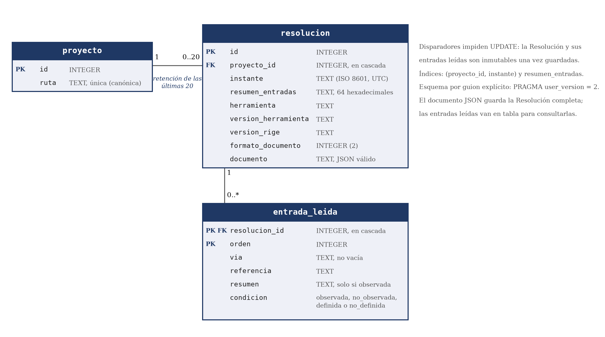

## IX.2 · Modelo de datos

### IX.2.1 · Del modelo del dominio al almacén

RF-17 exige conservar y fechar cada Resolución, recuperarla con los mismos valores, procedencias y Declaraciones desplazadas (CA-1), y conservar las últimas 20 por Proyecto (CA-3). Como el núcleo construye el estado completo, el almacén lo guarda como documento JSON con formato versionado.

El modelo del dominio comprende nueve entidades (III.2, Figura 1). Tres tienen representación en tablas del almacén: Proyecto, Resolución y Entrada de configuración leída. Elemento, Agente, Declaración, Sustitución y Regla de permiso se conservan dentro del documento. Los Hallazgos se calculan en vivo sobre las Entradas actuales y no se guardan (ADR-105).

La ruta canónica del Proyecto y las versiones de la herramienta y de RIGE de cada Resolución ocupan columnas. El resto del estado resuelto queda en el documento; el árbol de trabajo del Proyecto no se persiste. La especialización de Agente se conserva dentro del documento, conforme al modelo mixto del dominio (ADR-019).

Las consultas sobre Resoluciones guardadas se derivan del documento recuperado, sin volver a resolver las Entradas. La línea de comandos y las consultas en vivo de la web resuelven sobre las Entradas actuales. La Figura IX.2 muestra las tablas, sus claves y multiplicidades.

*Figura IX.2. Modelo de datos del almacén: tablas, claves y multiplicidades. Fuente: elaboración propia sobre los guiones de esquema del almacén.*

Los guiones de esquema del almacén definen las tablas, sus columnas y las siguientes restricciones (registro de la evidencia, Anexo I, A.I.11):

- La ruta del Proyecto es obligatoria y única. Cada Proyecto y cada Resolución tienen un identificador entero como clave primaria.

- Cada Resolución pertenece a un Proyecto y cada Entrada leída pertenece a una Resolución. Las claves foráneas establecen el borrado en cascada.

- El resumen del conjunto de Entradas es obligatorio y contiene 64 caracteres hexadecimales. El documento es obligatorio y debe ser JSON válido.

- Cada Entrada leída se identifica por la combinación del identificador de Resolución y su orden. La vía es obligatoria y distinta del texto vacío; la referencia también es obligatoria.

- La condición de una Entrada leída toma uno de cuatro valores: observada, no observada, definida o no definida. Su resumen individual admite un valor solo con la condición observada; para las restantes condiciones es nulo.

El almacén dispone de un índice por Proyecto e instante y otro por resumen del conjunto de Entradas. Los disparadores rechazan toda actualización de una Resolución o de sus Entradas leídas (ADR-061).

### IX.2.2 · Ciclo de vida y versionado

Una Resolución se crea, se consulta por su identificador y permanece inmutable. La retención conserva hasta 20 Resoluciones por Proyecto y depura las restantes dentro de la transacción de guardado. El orden usa el instante de cada Resolución y, ante empate, su identificador, ambos de mayor a menor (ADR-061).

El resumen del conjunto de Entradas permite indicar «sin cambios respecto de una Resolución anterior»; el producto todavía no calcula esa comparación. El índice por resumen se declara como previsión para esa comparación. Cada análisis calcula una Resolución nueva, sin caché ni reutilización de resultados, conforme a la opción B de ADR-023. La alternativa de caché se difiere por el riesgo de devolver un estado desactualizado ante un cambio no detectado (Anexo III, D-23).

E-01 activa el cambio si el peor caso supera 2000 ms, con esta regla: «Se pivota: caché por resumen de entradas si dominan la lectura o la resolución; limitación declarada si domina el arranque» (Instrumento 39, E-01). La condición sigue el diagnóstico por etapas de ADR-055.

Las variables que constituyen una Entrada aportan el resumen de su contenido al resumen del conjunto. Las que solo ubican una Entrada aportan su nombre y condición. El resumen individual de las variables permanece nulo en la tabla de Entradas leídas (ADR-104).

El esquema del almacén está en la versión 2, indicada por `user_version = 2`, y el documento está en el formato 2. Estas numeraciones son independientes en su definición, también respecto de la versión de RIGE y del esquema de salida (ADR-062). El paso al formato 2 eleva también el esquema a la versión 2 para que la verificación al arrancar rechace los almacenes anteriores (ADR-061).

El comando explícito e idempotente `bun run esquema` aplica los guiones en orden. Al arrancar, RIGE verifica la versión del almacén; ante una discrepancia, termina con el error de uso `almacen-sin-esquema`, que indica ese comando. Un documento con formato distinto de 2 produce el mismo error. Las Resoluciones del v1 no se convierten; el desarrollador repite el análisis (ADR-061).

RNF-04 excluye el contenido incorporado por Sustitución del archivo del almacén, de su registro de escritura anticipada y de su memoria compartida. El documento conserva solo el origen y la condición de la Sustitución. El borrado sobrescribe con ceros el contenido eliminado mediante `secure_delete = ON`, como defensa en profundidad, porque el contenido sustituido no llega al almacén por diseño (ADR-061, B5).

### IX.2.3 · Alternativas descartadas

Se descarta guardar la respuesta de cada consulta porque representa una consulta particular y pierde la Resolución fechada del dominio. Una consulta diferente sobre el mismo Agente obliga a resolver otra vez.

El modelo relacional completo lleva Declaraciones, valores, rastros y Declaraciones desplazadas a tablas. Se descarta porque duplica en el almacén el modelo que ya construye el núcleo y exige una migración con cada cambio del rastro.

El modelo híbrido cede la consulta de Elementos en SQL y limita el historial a 20 Resoluciones, a cambio de no duplicar el modelo del núcleo, con menor costo de mantenibilidad. Exige mantener un formato adicional con versión propia (ADR-061, B2).

Se descarta la retención ilimitada por el crecimiento del almacén ante altas sucesivas; la retención por antigüedad tampoco acota el volumen por Proyecto (ADR-061, B4). Las 20 Resoluciones provienen de RF-17 CA-3, validado con la referente. Su revisión se somete a E-02: si el flujo web incumple los umbrales, se evalúa escritura fuera de la solicitud o reducción de la retención mediante un ADR (Instrumento 39, E-02).

### IX.2.4 · Efecto de un requisito nuevo sobre el modelo

Los siguientes casos constituyen análisis de diseño hipotéticos. Su incorporación requiere una decisión posterior sobre el alcance y la compatibilidad.

Las relaciones entre Elementos previstas en RF-13, diferido, se agregarían a la Resolución que construye el núcleo y llevarían el documento al formato 3. Su ficha no fija una condición de activación. Se consideran dos opciones de compatibilidad:

La primera opción repite el antecedente del formato 2 mediante un guion que eleve el esquema a la versión 3 y deje ilegibles las Resoluciones guardadas. Su costo es incumplir RF-17 CA-1 sobre lo ya guardado.

La segunda conserva un lector del formato 2 junto al del formato 3, para mantener RF-17 a costa de sostener dos lectores.

Una consulta histórica por Elemento, como examinar cómo cambia un permiso de un Agente entre Resoluciones, exigiría abrir cada documento. Para consultarla directamente en SQL haría falta una tabla de Elementos por Resolución. Esa incorporación requeriría una migración explícita por guion y una versión 3 del esquema, independiente del formato del documento.

La incorporación de otra herramienta exigiría revisar la identidad y la retención. Hoy la ruta del Proyecto es única sin distinguir herramienta y la retención borra por Proyecto. Dos adaptadores se desalojarían entre sí. Se requeriría retener por Proyecto y herramienta, que la Resolución ya registra, mediante un guion nuevo y la versión 3 del esquema, sin cambiar el núcleo.

Para decidir estos casos se evalúan las consultas requeridas, la compatibilidad de las Resoluciones guardadas y el costo de mantener lectores de formatos anteriores.
